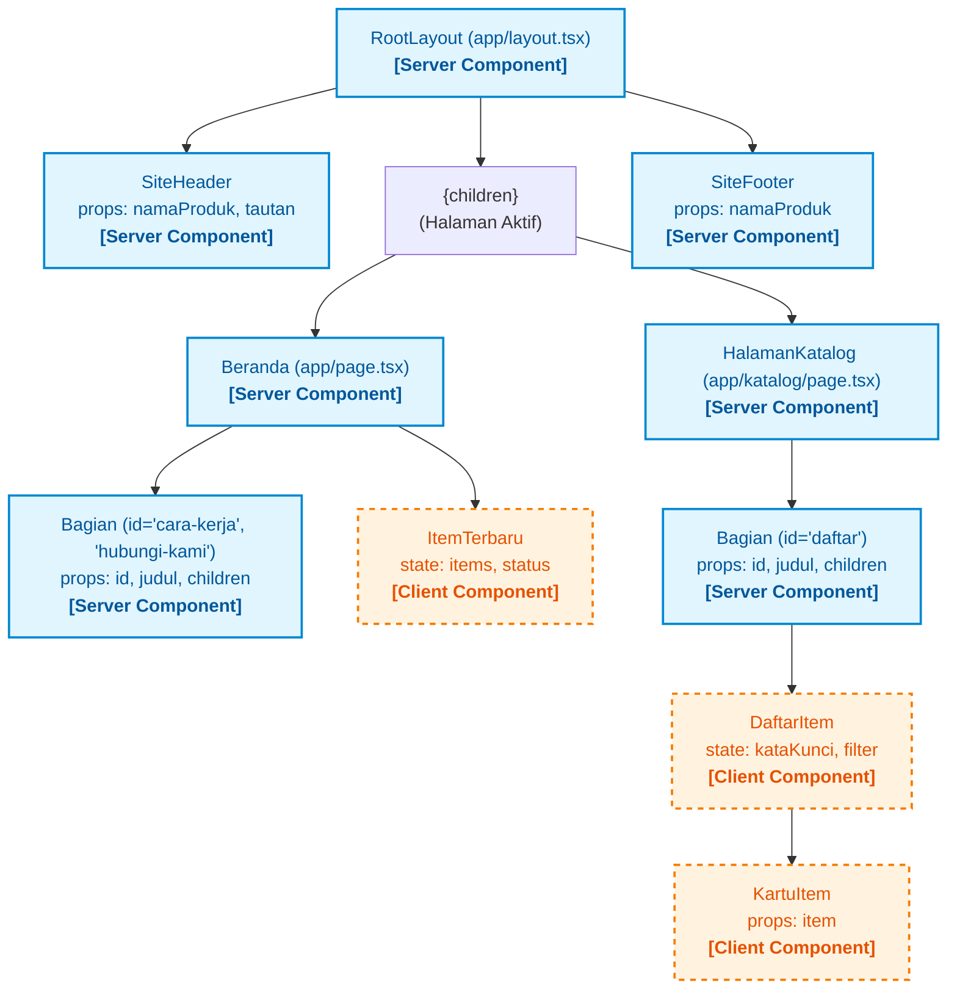
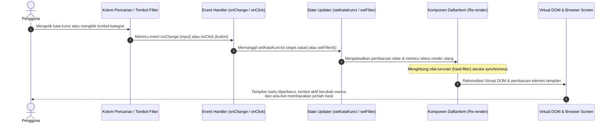

# Dokumen Teknis Modul 3 — TypeScript dan Komponen React

**Nama/NIM**   : Elisabeth Nainggolan / 105224037  
**Repositori** : https://github.com/Elisabethngl/105224037_PraktikumPemWeb  
**Branch**     : `main` (hasil penggabungan dari `praktikum/modul-03`)  

---

## 1. Tipe Data Produk

### Isi Berkas `lib/tipe.ts`

Berkas `lib/tipe.ts` mendefinisikan kontrak data utama untuk seluruh entitas produk dalam aplikasi. Berikut adalah implementasi lengkapnya:

```typescript
export type Kategori = "energi" | "lingkungan" | "kampus";

export interface Item {
  id: number;
  judul: string;
  kategori: Kategori;
  deskripsi: string;
  tersedia: boolean;
  gambar?: string;
}
```

### Alasan Pemilihan Union Type

Pada kode di atas, tipe `Kategori` didefinisikan menggunakan *union dari literal type*:
```typescript
export type Kategori = "energi" | "lingkungan" | "kampus";
```

Alasan teknis pemilihan *union type* meliputi:
1. **Type Safety Statis (*Compile-time Validation*)**: Membatasi nilai properti `kategori` hanya pada opsi string yang sah (`"energi"`, `"lingkungan"`, atau `"kampus"`). Jika terjadi saltik (*typo*) seperti memasukkan `"transportasi"`, pemeriksa tipe TypeScript (`tsc`) langsung mendeteksi kesalahan tersebut pada saat kode ditulis (`error TS2322: Type '"transportasi"' is not assignable to type 'Kategori'`), sebelum kode dikompilasi atau dijalankan di browser.
2. **Pemberian Autocomplete dan Refactoring Aman**: Editor (seperti Visual Studio Code) secara otomatis memberikan saran pilihan kategori yang valid dan mempermudah proses refactoring tanpa risiko data tidak konsisten.
3. **Penyelarasan dengan `Record<Kategori, string>`**: *Union type* memungkinkan penggunaan utilitas generik `Record<Kategori, string>` (seperti pada pemetaan label kategori di `KartuItem.tsx`). Apabila nantinya terdapat kategori baru yang ditambahkan pada `Kategori`, TypeScript akan memaksa pengembang mendefinisikan labelnya secara lengkap (*exhaustive check*).

### Alasan Pemilihan Properti Opsional

Properti `gambar?: string` pada antarmuka `Item` dinyatakan sebagai properti opsional menggunakan tanda tanya (`?`), yang merupakan sintaks pemendek dari `gambar: string | undefined`.

Alasan teknis pemilihan properti opsional:
1. **Fleksibilitas Data Katalog Awal**: Pada fase purwarupa atau penambahan data baru, tidak semua item memiliki aset gambar yang siap ditampilkan. Beberapa item hanya memerlukan data tekstual berupa `judul`, `kategori`, dan `deskripsi`.
2. **Menghindari Nilai Semu (*Dummy/Null Values*)**: Mengizinkan sebuah objek `Item` dibuat tanpa menyertakan properti `gambar` secara eksplisit, tanpa harus memberikan nilai tiruan kosong seperti `gambar: ""` atau `gambar: null`.
3. **Kompatibilitas Komponen Presentasi**: Memungkinkan komponen antarmuka melakukan conditional rendering secara aman (misalnya: `{item.gambar && }`) tanpa memicu kesalahan runtime saat properti tidak tersedia.

---

## 2. Struktur Komponen

### Diagram Pohon Komponen Akhir

Pemisahan komponen pada Modul 3 mengikuti arsitektur Next.js App Router yang membedakan secara tegas antara **Server Component** (dieksekusi di server untuk menghasilkan HTML murni) dan **Client Component** (mengandung kode interaktif sisi peramban yang dihidrasi dengan JavaScript).

#### Visualisasi Diagram Pohon Komponen



Tangkapan layar diagram hierarki pohon komponen modul praktikum:


*Gambar 2.1: Pohon komponen produk hasil Modul 3 (arsitektur Server Component dan Client Component).*

---

### Tabel Komponen

Berikut adalah ringkasan seluruh komponen React yang digunakan pada proyek:

| Nama Komponen | Jenis Komponen | Props dan Tipe | State yang Dikelola | Tempat Digunakan | Deskripsi dan Fungsi |
|---|---|---|---|---|---|
| `RootLayout` | Server Component | `{ children: React.ReactNode }` | Tidak ada | `app/layout.tsx` | Tata letak global aplikasi, menyediakan kerangka `<html>`, `<body>`, skip-link aksesibilitas, serta memuat `SiteHeader` dan `SiteFooter` secara konsisten di semua rute. |
| `SiteHeader` | Server Component | `namaProduk: string`<br/>`tautan: { href: string; label: string }[]` | Tidak ada | `app/layout.tsx` | Menampilkan navigasi utama aplikasi dengan tautan responsif ke Beranda (`/`) dan Katalog (`/katalog`). |
| `SiteFooter` | Server Component | `namaProduk: string` | Tidak ada | `app/layout.tsx` | Menampilkan catatan hak cipta dan penutup halaman di bagian bawah tata letak. |
| `Bagian` | Server Component | `id: string`<br/>`judul: string`<br/>`children: React.ReactNode` | Tidak ada | `app/page.tsx`<br/>`app/katalog/page.tsx` | Komponen pembungkus (*wrapper*) reusable yang membungkus section dengan elemen semantik `<section id={id} aria-labelledby={...}>` dan heading `<h2>`, memastikan keteraturan hierarki judul dan styling Tailwind. |
| `KartuItem` | Client Component *(diimpor oleh Client Component)* | `item: Item` | Tidak ada | `components/DaftarItem.tsx` | Komponen kartu satuan yang menampilkan informasi `judul`, label kategori terpetakan dari `Record<Kategori, string>`, `deskripsi`, serta label bersyarat jika item tidak tersedia. |
| `DaftarItem` | Client Component (`"use client"`) | `items: Item[]` | `kataKunci: string`<br/>`filter: Filter` | `app/katalog/page.tsx` | Komponen interaktif utama katalog yang mengelola input pencarian teks, pemilihan filter kategori, penghitungan hasil turunan (*derived state*), live-region pembaca layar, dan pemetaan grid kartu. |
| `ItemTerbaru` | Client Component (`"use client"`) | Tidak ada | `items: Item[]`<br/>`status: Status` | `app/page.tsx` | Mengambil data tiruan secara asinkron dari `/data/item.json` via Fetch API di dalam `useEffect`, menampilkan 3 item teratas dengan penanganan status loading, sukses, dan error. |

---

### Penjelasan Keputusan Teknis

#### 1. Alasan Pemecahan Komponen
Pemecahan antarmuka ke dalam komponen-komponen mandiri didasarkan pada prinsip reusabilitas (*Don't Repeat Yourself / DRY*) dan pemisahan tanggung jawab (*Single Responsibility Principle*):
- **Menghindari Duplikasi Markup**: Pada Modul 2, elemen `<header>`, `<footer>`, dan `<section>` beserta heading `<h2>` ditulis berulang di berbagai bagian kode. Dengan mengekstraksinya menjadi `SiteHeader`, `SiteFooter`, dan `Bagian`, struktur HTML semantik terpusat di satu tempat sehingga konsisten dan mudah dirawat.
- **Isolasi Logika Presentasi**: Komponen `KartuItem` difokuskan murni untuk menyajikan satu entitas `Item`. Hal ini memisahkan logika penyajian kartu dari logika pencarian/penyaringan yang dikelola oleh `DaftarItem`.
- **Fleksibilitas Komposisi melalui Prop `children`**: Komponen `Bagian` menggunakan prop `children: React.ReactNode` sebagai pembungkus yang agnostik terhadap konten di dalamnya, sehingga dapat membungkus teks penjelasan, formulir kontak, maupun grid katalog interaktif.

#### 2. Alasan Penempatan Direktif `"use client"`
Pada arsitektur Next.js App Router, penempatan direktif `"use client"` mengikuti aturan *best practice* yaitu **diletakkan sedalam mungkin pada pohon komponen (*leaf nodes*)**:
- Komponen level atas seperti `RootLayout`, `Beranda` (`app/page.tsx`), dan `HalamanKatalog` (`app/katalog/page.tsx`) dipertahankan sebagai **Server Component**. Komponen-komponen ini tidak membutuhkan *event listener* browser atau state reaktif, sehingga kode JavaScript-nya tidak perlu dikirimkan ke peramban (mengurangi ukuran *bundle size* klien dan mempercepat *First Contentful Paint*).
- Direktif `"use client"` secara ketat hanya disematkan pada berkas yang membutuhkan API peramban dan hook React:
  - `components/DaftarItem.tsx`: Menggunakan `useState` untuk menyimpan string kata kunci dan kategori filter, serta *event handler* `onChange` dan `onClick`.
  - `components/ItemTerbaru.tsx`: Menggunakan `useEffect` untuk melakukan permintaan HTTP Fetch API setelah komponen dimount pada peramban, serta `useState` untuk mengelola status asinkron (`memuat`, `berhasil`, `gagal`).
- Komponen `KartuItem.tsx` tidak memerlukan `"use client"` secara mandiri karena tidak menggunakan hook, namun secara otomatis ikut dieksekusi di sisi klien karena diimpor dan dirender di dalam `DaftarItem.tsx`.

---

## 3. State dan Interaksi

### Tangkapan Layar Tab Components (React Developer Tools)

Pengujian interaktivitas dilakukan pada rute `/katalog` menggunakan ekstensi React Developer Tools. Panel *Components* mengonfirmasi bahwa props dan hooks terikat dengan tepat:


*Gambar 3.1: Tangkapan layar panel React Developer Tools (Tab Components) pada komponen `DaftarItem`, memperlihatkan props `items` (6 data) dan hooks State 1 (`kataKunci = "sistem"`) serta State 2 (`filter = "lingkungan"`), dengan keluaran halaman "0 item ditemukan" dan pesan bersyarat "Tidak ada item yang sesuai."*

---

### Penjelasan Alur dari Event hingga Render Ulang

Komponen `DaftarItem` mengimplementasikan pola *controlled component* dan *derived state*. Alur interaktivitas berlangsung secara runtut sebagai berikut:



1. **Inisialisasi Nilai State Awal**:
   Saat halaman katalog pertama kali dibuka, hook `useState("")` menginisialisasi state `kataKunci` dengan nilai string kosong `""`, dan hook `useState<Filter>("semua")` menginisialisasi state `filter` dengan nilai `"semua"`. Seluruh 6 item ditampilkan pada layar.
2. **Pemicuan Event Masukan Pengguna**:
   - **Pencarian Teks**: Ketika pengguna mengetik (misalnya kata `"sistem"`), elemen `<input type="search">` memicu event `onChange`. Handler inline `(e) => setKataKunci(e.target.value)` menangkap nilai terkini dari `e.target.value`.
   - **Pemilihan Kategori**: Ketika pengguna mengklik tombol filter (misalnya tombol `"lingkungan"`), event `onClick` dipicu dan menjalankan `() => setFilter(k)`.
3. **Penjadwalan Render Ulang (*State Scheduling*)**:
   Pemanggilan fungsi pengubah state (`setKataKunci` atau `setFilter`) memberitahu React bahwa state komponen telah berubah. React kemudian menjadwalkan siklus render ulang (*re-render*) untuk fungsi komponen `DaftarItem`.
4. **Evaluasi Nilai Turunan (*Derived State Calculation*)**:
   Alih-alih menyimpan daftar hasil saringan ke dalam state baru (yang dapat memicu *bug desinkronisasi*), variabel `hasil` dihitung langsung dari kombinasi props `items` serta state `kataKunci` dan `filter` pada setiap siklus eksekusi fungsi render:
   ```typescript
   const hasil = items.filter((item) => {
     const cocokKata = item.judul
       .toLowerCase()
       .includes(kataKunci.toLowerCase());
     const cocokKategori = filter === "semua" || item.kategori === filter;
     return cocokKata && cocokKategori;
   });
   ```
5. **Rekonsiliasi Virtual DOM dan Pembaruan Tampilan**:
   React membandingkan Virtual DOM hasil render baru dengan Virtual DOM sebelumnya:
   - Atribut `aria-pressed={filter === k}` diperbarui sehingga tombol yang terpilih mendapatkan gaya visual aktif (latar biru `bg-blue-700 text-white`).
   - Paragraf `<p aria-live="polite">` diperbarui menampilkan teks jumlah item (`"{hasil.length} item ditemukan"`). Atribut `aria-live="polite"` memastikan teknologi asistif (pembaca layar) mengumumkan perubahan jumlah hasil tanpa menginterupsi pengguna.
   - Evaluasi percabangan bersyarat (*conditional rendering*) `{hasil.length === 0 ? ... : ...}`:
     - Jika `hasil.length === 0`, React menampilkan pesan `<p className="mt-4">Tidak ada item yang sesuai.</p>`.
     - Jika terdapat item yang cocok, elemen `<ul>` dirender dan memetakan array menggunakan `hasil.map(item => <li key={item.id}><KartuItem item={item} /></li>)`. Kunci unik dan stabil `key={item.id}` memastikan efisiensi algoritma diffing React saat posisi atau jumlah item dalam daftar berubah.

---

## 4. Pengambilan Data

### Tangkapan Layar Panel Network untuk Permintaan `item.json`

Pengambilan data tiruan dilakukan melalui Fetch API pada endpoint `/data/item.json`. Permintaan HTTP ini terpantau secara transparan melalui panel *Network* pada DevTools browser:


*Gambar 4.1: Tangkapan layar panel Network pada DevTools browser saat memuat berkas `item.json`, menunjukkan status HTTP 200 OK, Type fetch, Initiator `ItemTerbaru.tsx:16`, dan ukuran payload 844 B.*

---

### Hasil Pengujian Tiga Kondisi Pengambilan Data

Komponen `ItemTerbaru.tsx` mengelola tiga kemungkinan status siklus hidup permintaan HTTP, yaitu:
```typescript
type Status = "memuat" | "berhasil" | "gagal";
```

Berikut adalah dokumentasi dan tangkapan layar pengujian untuk ketiga kondisi tersebut:

#### 1. Kondisi Memuat (*Loading*)
- **Perilaku**: Saat komponen pertama kali dimount, state `status` berada pada nilai awal `"memuat"`. Komponen merender `<p>Memuat data…</p>`.
- **Metode Pengujian**: DevTools Network throttling diatur pada profil *"Slow 4G"* atau simulasi latensi jaringan untuk menahan respons sementara waktu sehingga teks pemuatan terlihat jelas di layar.
- **Tangkapan Layar**:


*Gambar 4.2: Tampilan antarmuka pada kondisi memuat ("Memuat data…").*

---

#### 2. Kondisi Berhasil (*Success*)
- **Perilaku**: Permintaan ke `/data/item.json` mengembalikan status HTTP 200 dengan `res.ok === true`. Data JSON di-parse dan 3 item pertama dipotong menggunakan `data.slice(0, 3)`, kemudian disimpan ke state `items` dan status diubah menjadi `"berhasil"`. Komponen merender daftar grid kartu berisi judul ketiga item tersebut.
- **Metode Pengujian**: Akses rute beranda (`/`) dalam kondisi server lokal berjalan normal dan berkas `public/data/item.json` tersedia.
- **Tangkapan Layar**:


*Gambar 4.3: Tampilan antarmuka pada kondisi berhasil (3 item terbaru tampil pada grid beranda).*

---

#### 3. Kondisi Gagal (*Error*)
- **Perilaku**: Jika server mengembalikan respons kesalahan (misalnya HTTP 404 Not Found) atau terjadi pemutusan jaringan, blok `try-catch` menangkap galat tersebut dan mengubah status menjadi `"gagal"`. Komponen merender elemen pemberitahuan aksesibel: `<p role="alert">Data gagal dimuat. Muat ulang halaman.</p>`.
- **Metode Pengujian**: Mengubah sementara target URL permintaan pada `ItemTerbaru.tsx` menjadi `/data/tidak-ada.json` untuk memicu kode status HTTP 404.
- **Tangkapan Layar**:


*Gambar 4.4: Tampilan antarmuka pada kondisi gagal saat berkas tidak ditemukan (HTTP 404).*

---

### Analisis Teknis Perilaku Fetch API dan Penanganan Respon

Secara spesifikasi arsitektur Fetch API JavaScript:
- Fungsi `fetch()` **hanya akan menolak (*reject*) Promise jika terjadi kegagalan jaringan fatal (*network failure*)**, misalnya perangkat klien offline total, DNS lookup gagal, atau permintaan diblokir oleh CORS/firewall.
- Respons HTTP dari server yang mengembalikan kode status kesalahan klien atau server (seperti **404 Not Found** atau **500 Internal Server Error**) **tetap dianggap sebagai Promise yang terpenuhi (*resolve*)** karena server berhasil merespons permintaan HTTP.
- Oleh karena itu, pengembang wajib melakukan validasi manual terhadap properti boolean `res.ok` (yang bernilai `true` hanya jika status kode HTTP berada dalam rentang sukses 200–299):
  ```typescript
  const res = await fetch("/data/item.json");
  if (!res.ok) throw new Error(`HTTP ${res.status}`);
  ```
  Dengan melempar eksepsi secara eksplisit (`throw new Error(...)`), eksekusi kode segera berpindah ke blok `catch`, sehingga state `status` dapat diubah menjadi `"gagal"` dan antarmuka dapat menyajikan pesan peringatan yang tepat kepada pengguna.
- Selain itu, penggunaan variabel boolean `dibatalkan` di dalam fungsi pembersih (*cleanup function*) `useEffect`:
  ```typescript
  return () => {
    dibatalkan = true;
  };
  ```
  mencegah terjadinya pembaruan state pada komponen yang telah dilepas dari DOM (*unmounted*), sehingga menghilangkan potensi *race condition* dan peringatan kebocoran memori React.

---

## 5. Verifikasi

Verifikasi keabsahan kode dilakukan dengan menjalankan pemeriksa tipe statis TypeScript (`tsc`) dan linter resmi Next.js (`eslint`).

### Keluaran Perintah Terminal

```bash
# 1. Pemeriksaan Sistem Tipe TypeScript
npx tsc --noEmit
# Perintah selesai dengan kode keluar 0 tanpa galat tipe (clean exit).

# 2. Pemeriksaan Standar Penulisan Kode ESLint
npm run lint
> modul-3@0.1.0 lint
> eslint
# Perintah selesai dengan 0 error dan 0 warning.
```

### Bukti Tangkapan Layar Terminal


*Gambar 5.1: Hasil eksekusi `npx tsc --noEmit` dan `npm run lint` pada terminal Windows PowerShell, membuktikan bahwa proyek sepenuhnya bebas galat tipe dan lolos aturan linter.*

---

## 6. Kendala dan Penyelesaian

Selama pengerjaan praktikum Modul 3, terdapat beberapa kendala teknis yang dihadapi beserta langkah penyelesaiannya:

| No | Kendala yang Dihadapi | Penyebab Teknis | Solusi dan Langkah Penyelesaian |
|---|---|---|---|
| 1 | Galat TS2322 saat pengujian kategori baru di `lib/data.ts`. | Tipe `kategori` pada objek `Item` terikat secara ketat dengan *union literal type* `Kategori = "energi" \| "lingkungan" \| "kampus"`. Memasukkan nilai seperti `"transportasi"` ditolak oleh pemeriksa tipe. | Mengembalikan nilai kategori ke opsi yang terdaftar dalam union type yang sah, atau memperluas definisi `Kategori` pada `lib/tipe.ts` jika memang ada kategori baru yang ditambahkan. |
| 2 | Kesalahan sintaks saat inisialisasi awal proyek via terminal Windows PowerShell (`npx create-next-app@latest <modul-3>`). | Karakter tanda kurung siku `<>` diinterpretasikan oleh shell Windows (PowerShell/CMD) sebagai operator *redirection*, bukan bagian dari argumen nama folder. | Menjalankan perintah create-next-app tanpa tanda kurung: `npx create-next-app@latest modul-3`. |
| 3 | Fetch API tetap mengeksekusi blok sukses meskipun berkas data tiruan tidak ada (HTTP 404). | Sifat alami `fetch()` yang tidak me-reject Promise pada respons kode status 404 atau 500 selama respons HTTP diterima dari server. | Menambahkan pengecekan eksplisit `if (!res.ok) throw new Error(...)` sebelum melakukan parsing `await res.json()`, sehingga kontrol alur dilempar ke blok `catch`. |
| 4 | Peringatan ESLint `@typescript-eslint/no-unused-vars` pada berkas `app/page.tsx`. | Terdapat impor modul `import Link from "next/link";` pada baris pertama `app/page.tsx` yang tidak digunakan di dalam berkas karena seluruh navigasi utama telah dipindahkan ke `SiteHeader.tsx`. | Menghapus baris impor `Link` yang tidak terpakai dari `app/page.tsx` sehingga perintah `npm run lint` selesai dengan status 0 warning dan 0 error. |
| 5 | Potensi *state update on unmounted component* saat pengguna berpindah halaman dengan cepat sewaktu Fetch API sedang berjalan. | Permintaan asinkron `fetch()` yang selesai setelah komponen `ItemTerbaru` di-unmount dari DOM akan tetap memanggil `setItems()` dan `setStatus()`. | Mengimplementasikan fungsi pembersih (*cleanup function*) pada `useEffect` dengan variabel boolean lokal `dibatalkan` untuk membatalkan mutasi state jika komponen sudah dilepas. |

---

## 7. Catatan Pemanfaatan AI

Sesuai dengan ketentuan akademik praktikum, penggunaan asisten kecerdasan artifisial dicatat secara transparan, lengkap, spesifik, dan disertai metode verifikasinya:

| Aspek | Deskripsi Rincian |
|---|---|
| **Alat AI yang Digunakan** | Antigravity AI Assistant (didukung oleh Google DeepMind model) |
| **Perintah Utama (*Prompt*)** | 1. *"Tolong bantu aku mengerjakan dokumen teknis modul 3 ini sesuai panduan pdf dan kerangka Bagian H, lalu sinkronisasikan ke folder modul3."*<br/>2. Menganalisis pohon komponen dan alir data reaktif props-to-state pada Next.js App Router.<br/>3. Mengaudit dan membersihkan peringatan unused variables pada ESLint untuk memenuhi kelulusan `npm run lint` tanpa galat. |
| **Bagian yang Dibantu AI** | 1. **Penyusunan Kerangka Dokumen Teknis**: Memetakan struktur laporan sesuai standar Bagian H dan kriteria rubrik penilaian nilai maksimal (Skor 4).<br/>2. **Penjelasan Keputusan Teknis**: Menyusun argumentasi komprehensif mengenai keuntungan Server Component vs Client Component, penempatan direktif `"use client"` di *leaf node*, alasan union types dan optional properties.<br/>3. **Diagram Alir Reaktif & Arsitektur Komponen**: Membangun diagram Mermaid sequence dan flowchart pohon komponen yang merepresentasikan interaksi state, event, dan Virtual DOM reconciliation.<br/>4. **Pembersihan Kode**: Mengidentifikasi dan menghapus impor `Link` yang tidak terpakai di `app/page.tsx` guna memastikan kelulusan linter. |
| **Cara Verifikasi Hasil AI** | 1. **Pemeriksaan Tipe TypeScript**: Menjalankan perintah `npx tsc --noEmit` langsung di terminal lokal untuk memvalidasi bahwa seluruh tipe antarmuka, generic, dan union types bebas dari galat kompilasi.<br/>2. **Audit Kualitas Kode**: Menjalankan perintah `npm run lint` untuk memastikan kepatuhan terhadap aturan linting Next.js dan ESLint dengan hasil 0 masalah.<br/>3. **Inspeksi Langsung Melalui DevTools**: Membuka rute `/katalog` dan memeriksa hierarki komponen, props, serta hook state secara langsung pada tab *Components* React Developer Tools.<br/>4. **Uji Fungsionalitas Jaringan**: Memeriksa lalu lintas permintaan data `/data/item.json` pada tab *Network*, serta menguji skenario memuat (throttling), sukses, dan 404 (endpoint fiktif). |
