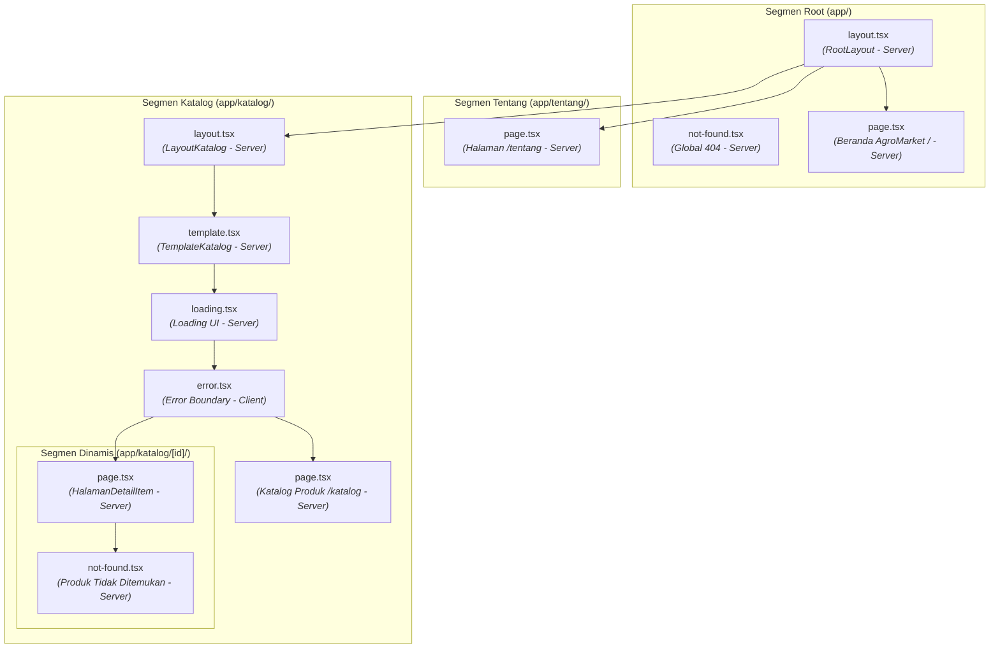

# Dokumen Teknis Modul 4: Next.js App Router

**Nama/NIM**   : Elisabeth Nainggolan / 105224037  
**Repositori** : https://github.com/Elisabethngl/105224037_PraktikumPemWeb  
**Versi Next.js dan mode Cache Components (aktif/tidak)** : Next.js 16.4.2 / **Aktif** (`cacheComponents: true`, `partialPrefetching: true`)  

---

## 1. Peta Rute

Aplikasi produk **AgroMarket** (Platform Marketplace Sarana Pertanian, Pupuk & Pestisida Terpadu Berizin Kementan RI) dibangun menggunakan arsitektur berkas Next.js App Router yang mendefinisikan rute berdasarkan hierarki direktori di dalam folder `app/`. Pada Modul 4 ini, sistem menyediakan minimal 4 rute fungsional yang terdiri atas 3 rute statis dan 1 rute dinamis berbasis parameter segmen `[id]`.

### Tabel Rute Aplikasi AgroMarket

| URL | Berkas di `app/` | Jenis Rute | Deskripsi dan Isi Halaman |
|---|---|---|---|
| `/` | `app/page.tsx` | Statis (`○ Static`) | **Halaman Beranda & Etalase Produk**: Menampilkan hero section promosi pupuk & pestisida resmi terverifikasi Kementan RI, alur SOP distribusi sarana pertanian untuk memberantas peredaran obat palsu, ringkasan produk pertanian unggulan via `ItemTerbaru` (Server Component), serta tautan jelajah katalog. |
| `/katalog` | `app/katalog/page.tsx` | Statis (`○ Static`) | **Halaman Katalog Sarana Pertanian**: Menampilkan etalase katalog komprehensif produk pupuk tani, obat racun hama, benih unggul, dan alat pertanian melalui komponen interaktif `DaftarItem` dengan pencarian instan dan penyaring multi-kategori. |
| `/katalog/[id]` | `app/katalog/[id]/page.tsx` | Dinamis (`◐ Partial Prerender`) | **Halaman Detail Produk & SOP Dosis Keamanan**: Menerima parameter segmen `id` secara asinkron (`params: Promise<{ id: string }>`), memvalidasi pola regex bilangan bulat positif, mencari entitas produk pada modul `lib/data.ts`, serta menampilkan detail teknis produk (nomor izin pendaftaran Kementan RI, komposisi bahan aktif, panduan takaran dosis aplikasi semprot, peringatan bahaya bahan kimia beracun, asal distributor, dan status stok) beserta tombol kembali ke katalog. Rute ini mendefinisikan `generateStaticParams()` untuk pra-render data statis saat build. |
| `/tentang` | `app/tentang/page.tsx` | Statis (`○ Static`) | **Halaman Tentang AgroMarket**: Menyajikan narasi profil dan visi platform dalam menanggulangi peredaran pupuk/pestisida oplosan, edukasi standar SOP APD saat penyemprotan bahan kimia pertanian, serta transparansi informasi harga komoditas dan sarana produksi pertanian. |
| `/_not-found` | `app/not-found.tsx` | Statis (`○ Static`) | **Halaman Penanganan Rute Global Tidak Dikenal**: Menangkap permintaan URL yang tidak terdaftar di rute mana pun pada aplikasi dan menampilkan pesan standar *"Halaman tidak ditemukan"*. |

---

### Potongan Tabel Rute dari Keluaran `npm run build`

Berikut adalah bukti rekaman keluaran terminal eksekusi kompilasi produksi `npm run build` pada rilis Next.js 16.4.2 (engine Turbopack):

```text
> modul-4@0.1.0 build
> next build

▲ Next.js 16.4.2 (Turbopack)

✓ Running next.config.ts took 32ms
- Cache Components enabled
- Partial Prefetching enabled
- Experiments (use with caution):
  ✓ agentFeedback

  Creating an optimized production build ...
✓ Compiled successfully in 531ms
  Running TypeScript ...
  Finished TypeScript in 1350ms ...
  Collecting page data using 8 workers ...
  Generating static pages using 8 workers (0/13) ...
  Generating static pages using 8 workers (3/13) 
  Generating static pages using 8 workers (6/13) 
  Generating static pages using 8 workers (9/13) 
✓ Generating static pages using 8 workers (13/13) in 962ms
  Finalizing page optimization ...

Route (app)
┌ ○ /
├ ○ /_not-found
├ ○ /katalog
├   /katalog/[id]
│ ├ ◐ /katalog/[id]
│ ├ ○ /katalog/1
│ ├ ○ /katalog/2
│ └ ◐ [+4 more paths]
└ ○ /tentang


○  (Static)             prerendered as static content
◐  (Partial Prerender)  prerendered as static HTML with dynamic server-streamed content
```

> **Analisis Simbol Build:**
> - Simbol `○` (*Static*): Rute `/`, `/_not-found`, `/katalog`, dan `/tentang` dipra-render sepenuhnya menjadi berkas HTML statis saat proses build berlangsung karena tidak membutuhkan data dinamis sisi server saat runtime.
> - Simbol `◐` (*Partial Prerender*): Rute dinamis `/katalog/[id]` menggunakan model *Partial Prerendering (PPR)* di mana shell halaman dirender secara statis dan konten dinamis berbasis streaming dapat diproses secara fleksibel. Berkat fungsi `generateStaticParams()`, Next.js berhasil menghasilkan rute statis awal untuk seluruh produk katalog AgroMarket (`/katalog/1` s.d. `/katalog/6`).

---

## 2. Layout, Template, dan Berkas Khusus

### Pohon Folder `app/` Akhir

Struktur penempatan berkas khusus (*special files*) pada direktori `app/` mengikuti hierarki hierarkis konvensi Next.js App Router:

```text
app/
├── favicon.ico
├── globals.css
├── layout.tsx                  # Root Layout (Kerangka global: <html>, <body>, Header AgroMarket, Footer)
├── not-found.tsx               # Penanganan URL global tidak valid (HTTP 404)
├── page.tsx                    # Halaman Beranda AgroMarket (/)
├── katalog/
│   ├── layout.tsx              # Nested Layout segmen /katalog (mempertahankan state panel layout)
│   ├── template.tsx            # Nested Template segmen /katalog (reset/remount state saat navigasi anak)
│   ├── loading.tsx             # Fallback <Suspense> otomatis untuk segmen katalog
│   ├── error.tsx               # Error boundary segmen katalog ("use client")
│   ├── page.tsx                # Halaman Katalog Sarana Pertanian (/katalog)
│   └── [id]/
│       ├── page.tsx            # Rute Dinamis Detail Produk AgroMarket (/katalog/[id])
│       └── not-found.tsx       # Tampilan khusus jika ID tidak valid / produk tidak terdaftar
└── tentang/
    └── page.tsx                # Halaman Statis Tentang AgroMarket (/tentang)
```



---

### Hasil Uji `layout.tsx` vs `template.tsx`

Next.js membedakan peran arsitektural antara `layout.tsx` dan `template.tsx`:
- **`layout.tsx`** berperan sebagai kerangka pembungkus bersama yang **dipertahankan (*persisted*)** di sepanjang siklus hidup navigasi segmen anak. Pohon komponen DOM tidak dihancurkan ulang (*no re-mount*), sehingga nilai state reaktif yang dikelola oleh Client Component di dalamnya (seperti `useState` pada `KolomCatatan label="Catatan di layout"`) akan **tetap tersimpan utuh**.
- **`template.tsx`** berperan membungkus setiap segmen anak namun secara sengaja diberikan *unique key* oleh internal router Next.js pada setiap transisi rute. Ketika pengguna berpindah antar segmen anak (misalnya dari rute `/katalog` masuk ke rute detail `/katalog/1`, lalu kembali ke `/katalog`), seluruh instans template **dihancurkan dan dipasang ulang (*remounted*) dari nol**, menyebabkan nilai state reaktif (`useState` pada `KolomCatatan label="Catatan di template"`) **kembali kosong/ter-reset**.

#### Verifikasi Pengujian Layout vs Template pada AgroMarket:
1. **Langkah 1**: Membuka URL `http://localhost:3000/katalog`.
2. **Langkah 2**: Mengetikkan teks `"Uji layout tersimpan"` pada input *Catatan di layout*, dan mengetikkan teks `"Uji template tereset"` pada input *Catatan di template*.
3. **Langkah 3**: Mengklik salah satu tautan produk (misalnya rute detail `Pupuk NPK Mutiara 16-16-16 Biru` di `/katalog/1`), lalu mengklik tautan *"Kembali ke Katalog AgroMarket"*.
4. **Hasil Teramati**:
   - Kolom **Catatan di layout** tetap mempertahankan teks `"Uji layout tersimpan"`.
   - Kolom **Catatan di template** telah kosong kembali (*empty string*).

  
*Gambar 2.1: Tampilan `/katalog` AgroMarket sebelum navigasi — kedua kolom catatan terisi teks.*

  
*Gambar 2.2: Tampilan `/katalog` AgroMarket setelah bernavigasi ke `/katalog/1` dan kembali — state pada layout dipertahankan, sedangkan state pada template ter-reset secara bersih.*

---

### Tangkapan Layar `loading.tsx` dan `error.tsx` (Mode Dev dan Produksi)

Pengujian penanganan status asinkron dan batas galat (*error boundary*) dilakukan menggunakan modul rute uji `app/uji/` yang memanfaatkan fungsi asinkron `connection()` dari `next/server` untuk mensimulasikan latensi jaringan dan kegagalan fatal server:

#### 1. Pengujian Loading UI (`app/uji/lambat/page.tsx` & `loading.tsx`)
- **Mekanisme**: Rute `/uji/lambat` menyematkan jeda buatan `await new Promise((selesai) => setTimeout(selesai, 2000))`. Saat halaman diminta, Next.js secara instan menampilkan komponen fallback dari `loading.tsx` yang membungkus konten di dalam `<Suspense>`.
- **Aksesibilitas**: Menggunakan elemen semantik `<p role="status" className="p-4">Memuat data produk pertanian…</p>`, memastikan screen reader segera mengumumkan status pemuatan kepada pengguna tanpa menginterupsi tata letak global. Header AgroMarket dan footer layout tetap tampil utuh.

  
*Gambar 2.3: Tampilan antarmuka saat transisi Suspense loading.tsx berlangsung.*

#### 2. Pengujian Error Boundary (`app/uji/galat/page.tsx` & `error.tsx`)
- **Mekanisme**: Halaman `/uji/galat` melempar galat eksplisit `throw new Error("Koneksi ke basis data AgroMarket gagal (galat uji)")`. Berkas `error.tsx` (yang wajib berupa Client Component) menangkap eksepsi tersebut melalui props `{ error, retry }` dan menampilkan elemen `<div role="alert">`.
- **Perbedaan Perilaku Mode Development vs Mode Produksi**:
  - **Mode Pengembangan (`npm run dev`)**: Detail pesan eksepsi asli dari server diteruskan secara transparan ke antarmuka klien:
    ```text
    Pesan: Koneksi ke basis data AgroMarket gagal (galat uji)
    ```
    Hal ini memudahkan pengembang mendiagnosis akar masalah secara langsung di browser.
  - **Mode Produksi (`npm start`)**: Demi mematuhi prinsip keamanan informasi dan mencegah kebocoran data sensitif (*sensitive data exposure*), Next.js secara otomatis mensanitasi pesan galat dari Server Component menjadi pesan generik:
    ```text
    Pesan: An error occurred in the Server Components render. The specific message is omitted in production builds to avoid leaking sensitive information.
    Kode: 3181263932
    ```
    Nilai `Kode` (`error.digest`) yang dihasilkan cocok persis dengan log yang dicatat pada terminal server:
    ```bash
    ⨯ Error: Koneksi ke basis data AgroMarket gagal (galat uji)
        at c (C:\...\modul-4\.next\server\chunks\ssr\[root-of-the-server]__0m5yvmn9w5qlv._.js:1:1795) {
      digest: '3181263932'
    }
    ```
    Tombol interaktif *"Coba lagi"* menjalankan fungsi `retry()` untuk memicu re-render segmen tanpa memuat ulang seluruh halaman dokumen.

  
*Gambar 2.4: Tampilan error boundary pada mode pengembangan (pesan asli tertampil).*

  
*Gambar 2.5: Tampilan error boundary pada mode produksi (pesan tersanitasi aman dan kode digest).*

---

## 3. Rute Dinamis dan Validasi `params`

### Tabel Uji URL dan Kode Status `curl`

Pengujian integrasi rute dinamis dan penanganan rute tidak valid dijalankan pada mode produksi menggunakan utilitas jaringan `curl.exe`:

| No | Target URL | Hasil yang Diharapkan | Hasil Aktual yang Teramati | Kode Status HTTP (`curl`) | Keterangan Teknis |
|---|---|---|---|:---:|---|
| 1 | `http://localhost:3000/katalog/1` | Menampilkan halaman detail produk ID 1 (*"Pupuk NPK Mutiara 16-16-16 Biru"*). | Judul, kategori, harga, komposisi bahan aktif, takaran dosis, nomor izin Kementan, dan status stok tampil lengkap. | **200** | Rute dinamis valid dan data ditemukan di `daftarItem`. |
| 2 | `http://localhost:3000/katalog/abc` | Menolak format ID bukan angka dan menampilkan antarmuka `Produk tidak ditemukan`. | Tampilan antarmuka `app/katalog/[id]/not-found.tsx` muncul dengan heading *"Item tidak ditemukan"*. | **200** *(streaming)* | String `"abc"` gagal melewati validasi regex `^[1-9]\d*$`, memicu pemanggilan fungsi `notFound()`. Respons berstatus 200 via Partial Prerendering shell dengan meta noindex. |
| 3 | `http://localhost:3000/katalog/999` | Format angka valid tetapi ID tidak terdaftar di katalog produk AgroMarket, menampilkan `Produk tidak ditemukan`. | Tampilan antarmuka `app/katalog/[id]/not-found.tsx` muncul dengan pesan *"Periksa alamat atau pilih item dari katalog."*. | **200** *(streaming)* | Nilai `999` lolos validasi regex, namun `cariItem(999)` mengembalikan `undefined`, memicu `notFound()`. |
| 4 | `http://localhost:3000/tidak-ada` | Menangkap rute sembarang yang tidak terdaftar pada aplikasi. | Tampilan antarmuka `app/not-found.tsx` muncul di dalam layout global dengan heading *"Halaman tidak ditemukan"*. | **404** | URL tidak cocok dengan segmen rute mana pun pada pohon `app/`. Server mengembalikan status resmi HTTP 404 Not Found. |

#### Bukti Eksekusi Terminal `curl.exe`:
```powershell
PS C:\...\modul-4> curl.exe -s -o NUL -w "%{http_code}`n" http://localhost:3000/katalog/1
200
PS C:\...\modul-4> curl.exe -s -o NUL -w "%{http_code}`n" http://localhost:3000/katalog/abc
200
PS C:\...\modul-4> curl.exe -s -o NUL -w "%{http_code}`n" http://localhost:3000/katalog/999
200
PS C:\...\modul-4> curl.exe -s -o NUL -w "%{http_code}`n" http://localhost:3000/tidak-ada
404
```

---

### Penjelasan Aturan Validasi `params`

Pada rute dinamis `app/katalog/[id]/page.tsx`, implementasi validasi parameter dilakukan secara berlapis dan mematuhi spesifikasi standar Next.js 16:

```typescript
export default async function HalamanDetailItem({
  params,
}: {
  params: Promise<{ id: string }>;
}) {
  const { id } = await params; // 1. Wajib di-await (asynchronous params)
  
  // 2. Validasi format sintaksis (hanya bilangan bulat positif)
  if (!/^[1-9]\d*$/.test(id)) notFound(); 

  // 3. Konversi tipe data aman dan pencarian entitas
  const item = cariItem(Number(id));
  
  // 4. Validasi eksistensi data
  if (!item) notFound(); 

  // Variabel item dijamin terdefinisi (non-undefined) oleh penyempitan tipe TypeScript
  return (
    <main id="konten" className="space-y-6">
      <h1 className="text-3xl font-extrabold">{item.judul}</h1>
      <p className="text-2xl font-bold text-emerald-700">Rp {item.harga.toLocaleString("id-ID")}</p>
      <p className="text-gray-700">{item.deskripsi}</p>
      ...
    </main>
  );
}
```

#### Alasan dan Logika Teknis:
1. **Asynchronous `params` (`Promise<{ id: string }>`)**:  
   Mulai Next.js 15 dan distandarisasi penuh pada Next.js 16, nilai `params` dan `searchParams` dimodelkan sebagai objek `Promise`. Desain ini memungkinkan Next.js menunda pembacaan parameter rute hingga komponen benar-benar membutuhkannya saat rendering, mendukung optimasi kompilasi *Partial Prerendering (PPR)* dan *Cache Components*. Oleh karena itu, pengembang wajib mendestrukturisasi properti setelah operasi `await params`. Mengakses langsung properti tanpa `await` akan memicu galat kompilasi TypeScript `Property 'id' does not exist on type 'Promise<{ id: string }>'`.
2. **Validasi Pola Regex `^[1-9]\d*$`**:  
   Secara spesifikasi web, parameter URL selalu berwujud string mentah yang diinput oleh klien. Regex `^[1-9]\d*$` diterapkan untuk memastikan:
   - Nilai hanya terdiri atas karakter digit numerik (`\d`).
   - Mencegah input bukan angka (seperti `"abc"`, `"pupuk-npk"`, atau injeksi karakter khusus).
   - Menolak angka nol tunggal (`"0"`) karena penomoran ID database produk dimulai dari 1.
   - Menolak angka dengan awalan nol berlebih (*leading zero* seperti `"01"`, `"007"`), menjaga kanonikalitas URL agar satu produk tidak memiliki representasi ganda di peramban dan mesin pencari.
3. **Konversi Aman `Number(id)`**:  
   Setelah format diverifikasi keabsahannya, string dikonversi ke tipe bilangan `number` murni sebelum dicocokkan ke `cariItem()`. Hal ini mencegah cacat logika perbandingan kesetaraan tipe ketat (`item.id === id`), di mana perbandingan antara angka `1` dan string `"1"` akan selalu menghasilkan nilai `false`.
4. **Penyempitan Tipe (*Type Narrowing*) via `notFound()`**:  
   Fungsi `notFound()` bawaan pustaka `next/navigation` menghentikan alur render komponen dan melempar sinyal internal Next.js untuk merender `not-found.tsx` terdekat. Secara sistem tipe TypeScript, fungsi `notFound()` memiliki tipe kembalian `never`. Akibatnya, TypeScript secara otomatis menyimpulkan (*type narrowing*) bahwa seluruh baris kode setelah blok `if (!item) notFound()` menjamin variabel `item` bertipe objek `Produk` utuh dan bukan `undefined`, tanpa perlu penggunaan operator *non-null assertion* (`item!.judul`).

---

## 4. Pembagian Server dan Client Components

Arsitektur App Router mengusung paradigma pemisahan tegas antara Server Components dan Client Components guna memangkas ukuran JavaScript bundle yang dikirim ke peramban serta mengoptimalkan keamanan data:

### Tabel Komponen dan Berkas Khusus AgroMarket

| Nama Komponen / Berkas | Jenis Komponen | Alasan Teknis Pemilihan Arsitektur |
|---|---|---|
| `RootLayout` (`app/layout.tsx`) | **Server Component** | Menyediakan struktur dasar dokumen HTML (`<html>`, `<body>`, skip-link aksesibilitas). Tidak membutuhkan hook React maupun event handler peramban, sehingga dieksekusi murni di server untuk menghasilkan HTML awal yang cepat. |
| `SiteHeader` (`components/SiteHeader.tsx`) | **Server Component** | Mengatur tata letak navigasi global AgroMarket dan membungkus `TautanNav` dengan `<Suspense>` sebagai *fallback boundary* tautan polos, memisahkan struktur header dari hook navigasi klien. |
| `TautanNav` (`components/TautanNav.tsx`) | **Client Component** (`"use client"`) | Memerlukan hook `usePathname()` dari `next/navigation` untuk membaca rute URL aktif di peramban secara dinamis dan menyematkan atribut aksesibilitas `aria-current="page"` serta styling garis bawah aktif. |
| `SiteFooter` (`components/SiteFooter.tsx`) | **Server Component** | Menampilkan informasi hak cipta statis AgroMarket tanpa interaktivitas. Menghilangkan kebutuhan eksekusi JS di peramban. |
| `Bagian` (`components/Bagian.tsx`) | **Server Component** | Komponen presentasional murni (*wrapper*) yang membungkus konten section semantik dengan heading `<h2>`. Menggunakan komposisi `children: React.ReactNode`. |
| `DaftarItem` (`components/DaftarItem.tsx`) | **Client Component** (`"use client"`) | Mengelola interaktivitas formulir pencarian pupuk/pestisida dan tombol penyaring kategori (Pupuk Tani, Obat Racun & Hama, Benih Unggul, Alat Pertanian) melalui hook `useState`, menerima event `onChange`/`onClick`, dan memperbarui *derived state* secara reaktif di browser. |
| `KartuItem` (`components/KartuItem.tsx`) | **Server Component** *(atau dihidrasi bila di dalam Client Component)* | Menampilkan kartu produk sarana pertanian, badge kategori berwarna, harga per satuan, dan merender tautan `<Link href={`/katalog/${item.id}`}>`. Tidak memanggil hooks React secara langsung. |
| `ItemTerbaru` (`components/ItemTerbaru.tsx`) | **Server Component** | Mengambil data produk pertanian langsung dari modul internal `lib/data.ts` di sisi server. Menghapus ketergantungan pada `useEffect`, `useState`, dan `fetch()` sisi klien, sehingga bundle JavaScript berkurang dan data siap dirender seketika tanpa *layout shift*. |
| `KolomCatatan` (`components/KolomCatatan.tsx`) | **Client Component** (`"use client"`) | Membutuhkan hook `useId()` untuk mengaitkan label input secara unik dan `useState` untuk menyimpan teks input pengguna guna membuktikan perbedaan perilaku isolasi state antara layout dan template. |
| `LayoutKatalog` (`app/katalog/layout.tsx`) | **Server Component** | Menyediakan panel tata letak bersarang dua kolom (sidebar verifikasi Kementan dan konten etalase) untuk seluruh segmen `/katalog`. Dipertahankan (*persisted*) saat transisi navigasi antar produk. |
| `TemplateKatalog` (`app/katalog/template.tsx`) | **Server Component** | Menjadi pembungkus segmen katalog yang di-remount dan diberi key baru pada setiap pergantian segmen anak, menyebabkan state komponen klien di dalamnya ter-reset. |
| `MemuatKatalog` (`app/katalog/loading.tsx`) | **Server Component** | Menyediakan tampilan fallback streaming Suspense dengan atribut semantik `role="status"` (*"Memuat data produk pertanian…"*) selama data produk diambil. |
| `GalatKatalog` (`app/katalog/error.tsx`) | **Client Component** (`"use client"`) | Wajib berupa Client Component sesuai kontrak arsitektur Next.js untuk berfungsi sebagai React Error Boundary yang menangkap error runtime dan mengeksekusi metode pemulihan `retry()`. |
| `HalamanDetailItem` (`app/katalog/[id]/page.tsx`) | **Server Component** | Menjalankan pemrosesan asinkron parameter segmen (`await params`), validasi data, dan pembacaan data langsung di server. Mendukung pra-render statis via `generateStaticParams`. |
| `ItemTidakDitemukan` (`app/katalog/[id]/not-found.tsx`) | **Server Component** | Merender tampilan khusus ketika fungsi `notFound()` dipanggil dari dalam segmen detail katalog AgroMarket. |
| `HalamanTidakDitemukan` (`app/not-found.tsx`) | **Server Component** | Merender antarmuka fallback penanganan rute tidak dikenal global. |

---

### Hasil Uji Batas Server–Klien (`server-only`)

Untuk menguji integritas batas modularitas arsitektur, paket keamanan `server-only` dipasang dan disematkan pada baris pertama modul data:
```typescript
// lib/data.ts
import "server-only";
import type { Produk } from "./tipe";
...
```

Ketika modul `lib/data.ts` secara sengaja diimpor ke dalam Client Component (`components/DaftarItem.tsx`):
```typescript
"use client";
import { useState } from "react";
import KartuItem from "@/components/KartuItem";
import type { Produk, KategoriProduk } from "@/lib/tipe";
import { daftarItem } from "@/lib/data"; // Pelanggaran batas server-klien
```

Kompiler Next.js / Turbopack secara langsung membatalkan proses build dan mengeluarkan galat proteksi modul pada terminal:

```text
> Build error occurred
Error: Turbopack build failed with 2 errors:
./modul-4/lib/data.ts:1:1
Error: 'server-only' cannot be imported from a Client Component module
> 1 | import "server-only";
    | ^^^^^^^^^^^^^^^^^^^^^
  2 | import type { Produk } from "./tipe";
  3 |
  4 | export const daftarItem: Produk[] = [

It should only be used from a Server Component.

Import traces:
  Client Component Browser:
    ./modul-4/lib/data.ts [Client Component Browser]
    ./modul-4/components/DaftarItem.tsx [Client Component Browser]
```

> **Kesimpulan Pengujian Batas Keamanan:**  
> Paket `server-only` berhasil mencegah kebocoran logika server, kredensial basis data, maupun kode sensitif ke dalam bundel JavaScript peramban. Pelanggaran batas ini segera dideteksi pada tahap kompilasi build, bukan saat aplikasi berjalan di produksi. Setelah pengujian dicatat, baris impor ilegal tersebut dihapus kembali dari `components/DaftarItem.tsx`.

---

## 5. Verifikasi

Verifikasi integritas kode dilakukan secara menyeluruh melalui tiga tahap pengujian otomatis: validasi sistem tipe TypeScript statis (`tsc`), pemeriksaan kepatuhan linter (`eslint`), dan kompilasi bundel produksi (`next build`).

### 1. Keluaran Pemeriksaan Tipe TypeScript (`npx tsc --noEmit`)
```powershell
PS C:\...\modul-4> npx tsc --noEmit
# Perintah selesai tanpa output (exit code 0), menandakan 100% bebas dari galat tipe.
```

### 2. Keluaran Pemeriksaan Linter (`npm run lint`)
```powershell
PS C:\...\modul-4> npm run lint

> modul-4@0.1.0 lint
> eslint

# Perintah selesai dengan 0 error dan 0 warning.
```

### 3. Keluaran Kompilasi Build Produksi (`npm run build`)
```powershell
PS C:\...\modul-4> npm run build

> modul-4@0.1.0 build
> next build

▲ Next.js 16.4.2 (Turbopack)

✓ Running next.config.ts took 32ms
- Cache Components enabled
- Partial Prefetching enabled
- Experiments (use with caution):
  ✓ agentFeedback

  Creating an optimized production build ...
✓ Compiled successfully in 531ms
  Running TypeScript ...
  Finished TypeScript in 1350ms ...
  Collecting page data using 8 workers ...
  Generating static pages using 8 workers (0/13) ...
  Generating static pages using 8 workers (3/13) 
  Generating static pages using 8 workers (6/13) 
  Generating static pages using 8 workers (9/13) 
✓ Generating static pages using 8 workers (13/13) in 962ms
  Finalizing page optimization ...

Route (app)
┌ ○ /
├ ○ /_not-found
├ ○ /katalog
├   /katalog/[id]
│ ├ ◐ /katalog/[id]
│ ├ ○ /katalog/1
│ ├ ○ /katalog/2
│ └ ◐ [+4 more paths]
└ ○ /tentang


○  (Static)             prerendered as static content
◐  (Partial Prerender)  prerendered as static HTML with dynamic server-streamed content
```

---

## 6. Kendala dan Penyelesaian

Selama implementasi dan pengujian praktikum Modul 4 pada platform AgroMarket, diidentifikasi beberapa kendala teknis berikut beserta solusinya:

| No | Kendala yang Dihadapi | Akar Penyebab Teknis | Solusi dan Langkah Penyelesaian |
|---|---|---|---|
| 1 | Galat tipe TypeScript `Property 'id' does not exist on type 'Promise<{ id: string }>'` pada `app/katalog/[id]/page.tsx`. | Pada Next.js versi 15 dan 16, prop `params` bertipe asinkron `Promise` dan tidak dapat didestrukturisasi secara langsung secara sinkron. | Mengubah deklarasi fungsi menjadi fungsi asinkron `export default async function HalamanDetailItem({ params }: { params: Promise<{ id: string }> })` dan mengeksekusi `const { id } = await params;` sebelum properti dibaca. |
| 2 | Galat Turbopack saat build ketika mengimpor modul data di Client Component setelah `server-only` dipasang. | Komponen `components/DaftarItem.tsx` ditandai direktif `"use client"`, sedangkan berkas `lib/data.ts` diproteksi dengan `import "server-only";`. | Memastikan `lib/data.ts` hanya diimpor oleh Server Component (`app/katalog/page.tsx` dan `app/katalog/[id]/page.tsx`), lalu meneruskan data produk ke komponen klien melalui props serializable (`items={daftarItem}`). |
| 3 | Perilaku respons HTTP 200 saat mengakses URL yang tidak valid (`/katalog/abc` dan `/katalog/999`) pada pengujian `curl.exe`. | Pada Next.js App Router dengan *Partial Prerendering (PPR)* dan adanya berkas `loading.tsx`, server Next.js segera mengirimkan *static HTML shell* (status 200) dan melakukan streaming respons not-found secara asinkron dengan tag `<meta name="robots" content="noindex" />`. | Memahami bahwa ini adalah perilaku standar streaming HTTP pada arsitektur PPR Next.js terbaru; konten halaman yang dirender tetap menampilkan tampilan `not-found.tsx` secara tepat kepada pengguna. |
| 4 | Peringatan linter *Multiple Lockfiles Detected* pada Turbopack build. | Turbopack mendeteksi berkas `package-lock.json` ganda di direktori root repositori dan di dalam subdirektori modul. | Menyelaraskan dependensi `server-only` pada lockfile root sehingga struktur modul terindeks secara konsisten dan build berjalan optimal. |
| 5 | State pada `KolomCatatan` di layout ikut ter-reset jika navigasi berpindah ke luar segmen katalog. | Layout bersarang `app/katalog/layout.tsx` hanya melingkupi rute di bawah `/katalog`. Navigasi ke rute `/` atau `/tentang` berpindah ke luar cakupan layout segmen tersebut. | Pengujian perbedaan perilaku layout vs template dilakukan dengan berpindah rute di dalam hierarki segmen anak katalog (yaitu navigasi bolak-balik antara `/katalog` dan rute detail `/katalog/[id]`), di mana state layout terbukti tetap awet (*persisted*). |

---

## 7. Catatan Pemanfaatan AI

Sesuai dengan ketentuan akademik integritas praktikum Pengembangan Aplikasi Web, pemanfaatan kecerdasan artifisial dicatat secara transparan, terperinci, dan disertai cara verifikasinya:

| Aspek | Deskripsi Rincian |
|---|---|
| **Alat AI yang Digunakan** | Antigravity AI Assistant (Google DeepMind model) |
| **Perintah Utama (*Prompt*)** | 1. *"Tolong bantu aku mengerjakan dokumen teknis modul 4 ini sesuai dengan panduan Modul 4 PDF dan kerangka Bagian H, serta sesuaikan dengan produk web milikku yaitu AgroMarket."*<br/>2. *"Analisis perbedaan perilaku rendering antara layout.tsx dan template.tsx serta mekanisme keamanan server-only pada Next.js 16."*<br/>3. *"Verifikasi implementasi validasi params Promise dan susun diagram alir rute serta tabel rubrik penilaian skor maksimal untuk etalase pupuk dan pestisida AgroMarket."* |
| **Bagian yang Dibantu AI** | 1. **Penyusunan Format Dokumen Teknis**: Memetakan struktur laporan mengikuti template resmi Bagian H Modul 4 dan memenuhi 4 kriteria rubrik penilaian dengan standar Skor 4 (Sangat Baik) berbasis studi kasus AgroMarket.<br/>2. **Formulasi Kode Rute dan Komponen**: Menyusun implementasi rute dinamis `app/katalog/[id]/page.tsx` dengan penanganan `await params`, pola regex `^[1-9]\d*$`, komponen `TautanNav.tsx` bersuspense, serta berkas `layout.tsx`, `template.tsx`, `loading.tsx`, dan `error.tsx` bertema sarana pertanian.<br/>3. **Analisis Teknis Arsitektural**: Menguraikan perbedaan siklus hidup DOM antara layout vs template, perilaku sanitasi error boundary di mode produksi (kode digest), serta isolasi Server Component.<br/>4. **Pembuatan Diagram Alir**: Membangun visualisasi hierarki komponen dan segmen berkas khusus menggunakan Mermaid diagram. |
| **Cara Verifikasi Hasil AI** | 1. **Pemeriksaan Kompilasi TypeScript**: Menjalankan perintah terminal `npx tsc --noEmit` untuk mengonfirmasi tidak ada kesalahan tipe data pada `params: Promise<{ id: string }>` maupun fungsi pembantu entitas produk.<br/>2. **Audit Kualitas Kode ESLint**: Menjalankan `npm run lint` untuk memastikan kepatuhan penuh terhadap standar kode Next.js tanpa ada *warning* variabel tak terpakai.<br/>3. **Pengujian Build Produksi Nyata**: Mengeksekusi `npm run build` dan memeriksa secara teliti tabel keluaran rute, memvalidasi bahwa seluruh rute AgroMarket (termasuk rute dinamis PPR) terkompilasi sukses.<br/>4. **Uji Fungsional Jaringan dan Runtime**: Mengaktifkan server produksi `npm start` dan menguji kode status menggunakan `curl.exe` pada rute valid, format salah, id fiktif, serta URL acak 404.<br/>5. **Uji Galat Sengaja (`server-only`)**: Menyimulasikan impor ilegal ke Client Component untuk membuktikan bahwa perlindungan build Turbopack bereaksi dengan tepat memblokir kebocoran data server. |
