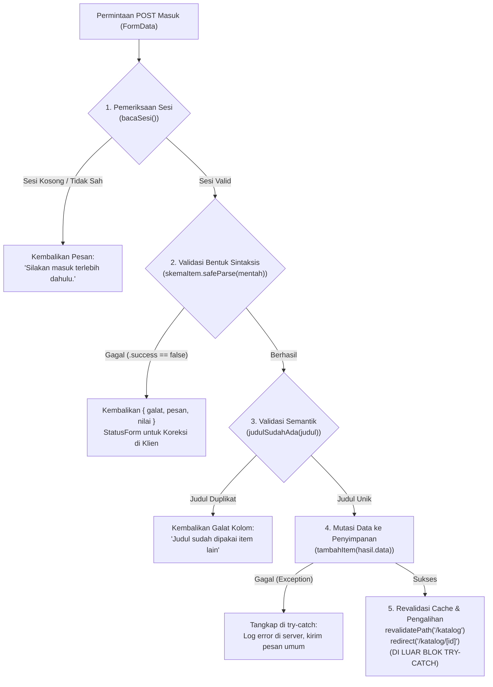

# Dokumen Teknis Modul 5 – Formulir, Validasi, Session, dan Cookie

**Nama/NIM**   : Elisabeth Nainggolan / 105224037  
**Repositori** : https://github.com/Elisabethngl/105224037_PraktikumPemWeb  
**Produk Web** : **AgroMarket** (Platform Marketplace Sarana Pertanian, Pupuk & Pestisida Terpadu Berizin Kementan RI)  
**Versi Zod / Framework** : Zod 4.x / Next.js 16.4.0 (React 19.3.0)  

---

## 1. Skema Validasi

Pada arsitektur aplikasi produk **AgroMarket**, pengiriman data melalui formulir dilindungi oleh skema validasi berbasis **Zod 4** yang dipusatkan pada direktori `lib/skema.ts` (serta direfleksikan pada subfolder `lib/schemas/productSchema.ts` dan `lib/schemas/authSchema.ts`). Validasi ini menjamin bahwa seluruh data masukan formulir yang masuk ke server memiliki struktur, tipe data, dan batasan panjang yang memenuhi standar legalitas produk pertanian berizin Kementerian Pertanian Republik Indonesia (Kementan RI).

### Tabel Aturan Validasi Formulir Tambah Item (`skemaItem`)

Formulir penambahan item katalog sarana pertanian (`/katalog/tambah`) memvalidasi 4 kolom utama masukan pengguna sebagai berikut:

| Nama Kolom | Tipe Data Masukan | Aturan Zod 4 (`skemaItem`) | Pesan Galat Spesifik | Keterangan & Batasan Teknis |
|---|---|---|---|---|
| `judul` | `string` | `.trim().min(3, "Judul minimal 3 karakter").max(80, "Judul maksimal 80 karakter")` | `"Judul minimal 3 karakter"` (jika < 3) / `"Judul maksimal 80 karakter"` (jika > 80) | Nama resmi merek pupuk, pestisida, benih unggul, atau alat pertanian. Whitespace berlebih dibersihkan secara otomatis menggunakan fungsi `.trim()`. |
| `kategori` | `enum` | `z.enum(["Pupuk Tani", "Obat Racun & Hama", "Benih Unggul", "Alat Pertanian"], { error: "Pilih salah satu kategori" })` | `"Pilih salah satu kategori"` | Wajib memilih salah satu dari 4 kategori resmi komoditas pertanian AgroMarket yang selaras dengan tipe serikat `KategoriProduk` pada `lib/tipe.ts`. |
| `deskripsi` | `string` | `.trim().min(10, "Deskripsi minimal 10 karakter").max(300, "Deskripsi maksimal 300 karakter")` | `"Deskripsi minimal 10 karakter"` (jika < 10) / `"Deskripsi maksimal 300 karakter"` (jika > 300) | Memuat informasi komposisi bahan aktif, aturan dosis anjuran, SOP perlindungan APD, serta nomor izin edar Kementan RI. |
| `tersedia` | `boolean` | `z.stringbool().default(false)` | *(Otomatis dikonversi ke nilai boolean default)* | Kotak centang (*checkbox*) ketersediaan stok fisik di etalase mitra tani. Nilai string `"on"` dari FormData HTML dikonversi menjadi boolean `true`, atau `false` apabila tidak dicentang. |

### Tabel Aturan Validasi Formulir Masuk Pengelola (`skemaMasuk`)

Halaman autentikasi pengelola katalog (`/masuk`) memvalidasi masukan kredensial menggunakan skema `skemaMasuk`:

| Nama Kolom | Tipe Data Masukan | Aturan Zod 4 (`skemaMasuk`) | Pesan Galat Spesifik | Keterangan & Batasan Teknis |
|---|---|---|---|---|
| `email` | `string` | `.trim().email("Format email tidak valid")` | `"Format email tidak valid"` | Alamat surat elektronik resmi pengelola atau admin AgroMarket. |
| `kataSandi` | `string` | `.min(8, "Kata sandi minimal 8 karakter")` | `"Kata sandi minimal 8 karakter"` | Kredensial rahasia pengelola dengan panjang minimum 8 karakter untuk memenuhi standar keamanan dasar. |

---

### Aturan Semantik yang Diperiksa di Server Action dan Alasannya

Di samping validasi bentuk sintaksis (*structural/shape validation*), sistem AgroMarket menerapkan **aturan semantik** yang tidak dapat diperiksa semata-mata oleh skema Zod pada level masukan FormData:

1. **Aturan Keunikan Judul Produk (`judulSudahAda`)**:
   - **Lokasi Pemeriksaan**: Fungsi Server Action `simpanItem` pada berkas `app/katalog/actions.ts` dengan memanggil helper `judulSudahAda(hasil.data.judul)` yang didefinisikan pada `lib/data.ts`.
   - **Logika Pemeriksaan**: Sistem melakukan normalisasi string (huruf kecil dan *trimming*) dan menelusuri seluruh data pada memori/penyimpanan produk (`daftarItem.some((i) => i.judul.toLowerCase() === dicari)`).
   - **Alasan Pemisahan dari Skema Zod**: Skema Zod bersifat *pure function* tanpa efek samping (*side-effect free*) yang bertugas memvalidasi struktur data masukan secara terisolasi. Skema Zod tidak memiliki akses konteks terhadap *state* persisten, basis data, atau tabel inventaris produk di server. Jika pemeriksaan keunikan dipaksakan masuk ke dalam skema Zod (misalnya melalui validasi asinkron `.refine()`), skema tersebut akan terikat erat (*tight coupling*) dengan sumber data eksternal, memperlambat proses parsing, dan menyulitkan pengujian unit (*unit testing*). Oleh karena itu, skema Zod difokuskan murni untuk validasi bentuk sintaksis, sedangkan validasi semantik dilakukan secara otoritatif pada alur Server Action sebelum mutasi terjadi.

---

## 2. Alur Server Action

Server Action Next.js bertindak sebagai *endpoint* HTTP POST publik yang dapat dipicu oleh peramban, *script* otomatis, maupun perkakas pengujian API (seperti cURL atau Postman). Oleh karena itu, Server Action `simpanItem` pada `app/katalog/actions.ts` menerapkan urutan pemeriksaan lima tahap yang sangat ketat dan defensif.

### Diagram Alur Pemeriksaan Bertahap Server Action `simpanItem`



### Penjelasan Rinci 5 Tahap Server Action

1. **Tahap 1: Pemeriksaan Sesi (`bacaSesi()`)**  
   Server Action memeriksa apakah pemanggil memiliki token sesi yang sah di penyimpanan server (`penyimpanan`). Jika pemanggil tidak memiliki sesi atau sesi telah kedaluwarsa, eksekusi langsung dihentikan dan mengembalikan `{ pesan: "Silakan masuk terlebih dahulu." }`. Tahap ini mencegah pengguna yang tidak terautentikasi melakukan konsumsi sumber daya komputasi validasi.
2. **Tahap 2: Validasi Bentuk Sintaksis (`skemaItem.safeParse()`)**  
   Data mentah `FormData` diekstraksi ke objek JavaScript dan divalidasi menggunakan skema Zod 4. Jika terdapat pelanggaran tipe data atau batasan panjang, Zod menghasilkan galat terstruktur yang diformat dengan `z.flattenError(hasil.error).fieldErrors` dan dikembalikan bersama salinan nilai masukan (`nilai`) agar peramban dapat menampilkan kembali isian sebelumnya tanpa menghapus teks yang telah diketik pengguna.
3. **Tahap 3: Validasi Semantik (`judulSudahAda()`)**  
   Memeriksa apakah judul item telah terdaftar sebelumnya di katalog AgroMarket. Jika duplikat ditemukan, aksi mengembalikan pesan galat khusus pada kolom judul `{ galat: { judul: ["Judul sudah dipakai item lain"] }, nilai }`.
4. **Tahap 4: Mutasi Data (`tambahItem()`)**  
   Data yang telah lolos validasi bentuk dan semantik dioper ke fungsi mutasi `tambahItem()`. Operasi ini dibungkus dalam blok `try-catch` khusus untuk menangani kemungkinan galat basis data/I/O. Jika terjadi kegagalan sistem, pesan teknis dicatat pada log internal server (`console.error`), sementara pengguna hanya menerima pesan ramah umum demi alasan keamanan (*information disclosure mitigation*).
5. **Tahap 5: Revalidasi Cache dan Pengalihan (`revalidatePath` dan `redirect`)**  
   - `revalidatePath("/katalog")` membatalkan cache halaman etalase katalog agar produk baru yang didaftarkan langsung terlihat oleh seluruh pengunjung.
   - `redirect('/katalog/${id}')` mengalihkan pengguna ke halaman detail produk yang baru saja dibuat.
   - **Kritikal**: Pemanggilan `redirect()` **harus diletakkan di luar blok `try-catch`**. Pada arsitektur Next.js, `redirect()` bekerja secara internal dengan melemparkan eksepsi khusus berjenis `NEXT_REDIRECT`. Apabila pemanggilan fungsi ini berada di dalam blok `try`, blok `catch` akan salah menangkap eksepsi pengalihan tersebut sebagai galat aplikasi biasa, sehingga navigasi peramban menjadi macet.

---

### Pembagian Peran Berkas: Server Component, Client Component, dan "use server"

| Kategori Berkas | Contoh Berkas | Direktif / Sifat | Tanggung Jawab dan Batasan Komputasi |
|---|---|---|---|
| **Server Component** | `app/katalog/tambah/page.tsx`, `app/masuk/page.tsx` | Default Next.js (tanpa direktif klien), dieksekusi secara asinkron di server. | Membaca sesi pengguna secara langsung sebelum halaman dirender (`const sesi = await bacaSesi()`), melakukan *early redirect* ke `/masuk` jika pengunjung tidak memiliki hak akses, dan merender kerangka halaman tanpa mengirimkan pustaka JavaScript berat ke peramban. |
| **Client Component** | `components/FormItem.tsx`, `components/FormMasuk.tsx` | Diimpor dengan `"use client"` di baris teratas berkas. | Menangani interaktivitas DOM, mendengarkan *event* pengiriman formulir menggunakan kait React 19 `useActionState`, menampilkan umpan balik validasi interaktif per kolom, mengelola status pemuatan tombol simpan (`pending`), serta memetakan atribut aksesibilitas WAI-ARIA (`aria-invalid`, `aria-describedby`). |
| **Berkas Server Action** | `app/katalog/actions.ts`, `app/masuk/actions.ts` | Menggunakan direktif `"use server"` di baris teratas berkas. | Mengekspos fungsi asinkron sisi server yang dapat dipanggil langsung dari Client Component melalui RPC internal Next.js. Bertanggung jawab penuh atas sanitasi masukan, validasi Zod, verifikasi sesi, mutasi basis data, dan manipulasi *cookie* HTTP. |

---

## 3. Bukti Uji Validasi

Sistem AgroMarket diuji menggunakan **8 skenario kasus uji** yang mencakup pengujian formulir normal, pelanggaran batas skema Zod, duplikasi semantik, hingga **3 kasus pengujian khusus dengan membypass validasi sisi klien browser** melalui penyuntikan atribut `novalidate` di konsol peramban.

### Tabel Kasus Uji Validasi Formulir AgroMarket

| ID Uji | Skenario Masukan | Mode Pengujian Klien | Hasil yang Diharapkan | Hasil Nyata (*Actual Output*) | Status |
|:---:|---|:---:|---|---|:---:|
| **TC-01** | **Item Lengkap & Sah**:<br>Judul: `"Pupuk Organik Granul Kascing"`<br>Kategori: `"Pupuk Tani"`<br>Deskripsi: `"Pupuk kotoran cacing tanah murni kaya unsur hara makro mikro dan bakteri penyubur tanah sawah."`<br>Tersedia: `true` | Validasi HTML Aktif | Data berhasil disimpan, cache rute `/katalog` direvalidasi, pengguna dialihkan ke `/katalog/7`. | Berhasil tersimpan dengan ID 7, dialihkan ke `/katalog/7`, produk baru langsung tampil pada etalase katalog. | **LULUS** |
| **TC-02** | **Judul Kurang dari 3 Karakter**:<br>Judul: `"ab"`<br>Kategori: `"Pupuk Tani"`<br>Deskripsi: `"Deskripsi standar produk sarana pertanian memenuhi syarat."`<br>Tersedia: `true` | Validasi HTML Aktif | Pengiriman ditahan di peramban oleh atribut HTML `minlength="3"`. | Browser menampilkan tooltip *"Please lengthen this text to 3 characters or more (you are currently using 2 characters)"*. | **LULUS** |
| **TC-03** | **Bypass Klien: Judul Terlalu Pendek**:<br>Judul: `"ab"`<br>Kategori: `"Pupuk Tani"`<br>Deskripsi: `"Deskripsi standar produk sarana pertanian memenuhi syarat."`<br>Tersedia: `true` | **`novalidate` Aktif** *(Klien Dilewati)* | Formulir terkirim ke server, Zod menolak, galat tampil tepat di bawah kolom judul. | Server Action menolak via `skemaItem.safeParse()`, peramban menampilkan pesan galat merah: `"Judul minimal 3 karakter"` di bawah kolom judul. | **LULUS** |
| **TC-04** | **Bypass Klien: Kategori Kosong**:<br>Judul: `"Bibit Jagung Manis Hibrida F1"`<br>Kategori: `""` *(Pilih kategori)*<br>Deskripsi: `"Benih jagung unggul tahan penyakit bulai dan kekeringan lahan tadah hujan."`<br>Tersedia: `true` | **`novalidate` Aktif** *(Klien Dilewati)* | Formulir terkirim ke server, Zod menolak karena tidak sesuai enum kategori, pesan galat tampil di bawah kolom kategori. | Server Action menolak, peramban menampilkan pesan galat: `"Pilih salah satu kategori"` di bawah dropdown kategori. | **LULUS** |
| **TC-05** | **Bypass Klien: Deskripsi Melebihi 300 Karakter**:<br>Judul: `"Herbisida Sistemik Glifosat Plus"`<br>Kategori: `"Obat Racun & Hama"`<br>Deskripsi: *[Teks panjang 412 karakter yang melanggar batas]*<br>Tersedia: `true` | **`novalidate` Aktif** *(Klien Dilewati)* | Formulir terkirim ke server, Zod menolak batas `.max(300)`, pesan galat tampil di bawah kolom deskripsi. | Server Action menolak, peramban menampilkan pesan galat: `"Deskripsi maksimal 300 karakter"`. Seluruh isian formulir tetap tersimpan di kolom via properti `nilai`. | **LULUS** |
| **TC-06** | **Pelanggaran Semantik: Judul Sudah Digunakan**:<br>Judul: `"Pupuk NPK Mutiara 16-16-16 Biru"` *(Produk ID 1)*<br>Kategori: `"Pupuk Tani"`<br>Deskripsi: `"Pupuk stok lama dari distributor resmi dengan kemasan 50kg."`<br>Tersedia: `true` | Validasi HTML Aktif | Skema Zod lolos, tetapi pemeriksaan semantik `judulSudahAda()` menolak duplikasi nama. | Pengiriman ditolak pada Tahap 3 Server Action, menampilkan pesan: `"Judul sudah dipakai item lain"` di bawah kolom judul, data tidak tersimpan ganda. | **LULUS** |
| **TC-07** | **Masuk dengan Format Email Tidak Sah**:<br>Email: `"pengelola_agromarket"` *(tanpa @domain)*<br>Kata Sandi: `"pertanian2026"` | **`novalidate` Aktif** *(Klien Dilewati)* | Server Action `masuk` menolak email tidak sesuai standar via `skemaMasuk`. | Pesan galat per kolom: `"Format email tidak valid"` tampil di bawah kolom email, sesi tidak dibuat. | **LULUS** |
| **TC-08** | **Masuk dengan Kredensial Salah**:<br>Email: `"pengelola@agromarket.com"`<br>Kata Sandi: `"sandiSalah123"` | Validasi HTML Aktif | Skema Zod lolos, verifikasi akun demo gagal di server. | Mengembalikan pesan umum `{ pesan: "Email atau kata sandi salah." }` di area status polite peramban. | **LULUS** |

---

### Tangkapan Layar Galat Per Kolom (`galat-per-kolom.png`)

Bukti pengujian saat atribut `novalidate` disuntikkan ke elemen `<form>` pada DevTools Elements untuk melumpuhkan seluruh validasi bawaan HTML5 browser. Ketiga galat server tampil serentak di bawah kolom yang bersangkutan dengan penandaan aksesibilitas ARIA:


*Gambar 1: Tangkapan layar formulir `/katalog/tambah` ketika validasi browser dilewati dengan atribut `novalidate`, menampilkan galat per kolom dari Zod 4 sisi server.*

> **Analisis Aksesibilitas WAI-ARIA pada Formulir:**
> - Kolom judul memuat atribut `aria-invalid="true"` dan `aria-describedby="galat-judul"`, menghubungkan kolom input secara semantik dengan elemen `<p id="galat-judul">Judul minimal 3 karakter</p>`.
> - Kolom kategori dan deskripsi menerapkan relasi identik (`aria-describedby="galat-kategori"` dan `aria-describedby="galat-deskripsi"`), sehingga perangkat pembaca layar (*screen reader*) bagi pengguna disabilitas netra dapat langsung mengumumkan deskripsi kesalahan ketika fokus berpindah ke kolom tersebut.
> - Pesan status umum dibungkus dalam kontainer `<p role="status" aria-live="polite">` agar perubahan status formulir diumumkan tanpa menginterupsi interaksi aktif pengguna.

---

## 4. Session dan Cookie

Autentikasi pengelola katalog AgroMarket diimplementasikan menggunakan arsitektur **Server-Side Session berbasis Cookie HTTP**. Berkas `lib/sesi.ts` mengisolasi seluruh manipulasi sesi di sisi server dengan memanfaatkan pustaka pembatas `import "server-only";` guna menjamin tidak ada kebocoran modul keamanan ke bundel JavaScript klien.

### Atribut Cookie Sesi dan Alasan Pemilihannya

Setiap sesi yang diterbitkan oleh fungsi `buatSesi(email)` dikirimkan ke peramban dengan konfigurasi atribut keamanan lengkap:

```typescript
(await cookies()).set("sesi", id, {
  httpOnly: true,
  secure: process.env.NODE_ENV === "production",
  sameSite: "lax",
  path: "/",
  maxAge: 28800, // 8 jam
});
```

| Atribut Cookie | Nilai Konfigurasi | Alasan Pemilihan & Ancaman Keamanan yang Dikurangi |
|---|---|---|
| `HttpOnly` | `true` | **Mencegah Pencurian Sesi via Serangan XSS (*Cross-Site Scripting*)**: Flag ini menginstruksikan peramban agar memblokir seluruh akses skrip JavaScript sisi klien terhadap *cookie* ini. Perintah seperti `document.cookie` di Console peramban akan menghasilkan string kosong, sehingga penyerang yang berhasil menyuntikkan skrip berbahaya tidak dapat mencuri token sesi pengguna. |
| `Secure` | `process.env.NODE_ENV === "production"` | **Mencegah Penyadapan Jaringan (*Man-in-the-Middle/Eavesdropping*)**: Memastikan *cookie* hanya ditransmisikan melalui protokol terenkripsi HTTPS pada lingkungan produksi publik. Pada lingkungan pengembangan lokal (*development*), nilai disetel ke `false` agar pengujian di `http://localhost:3000` tetap dapat berjalan tanpa mewajibkan sertifikat SSL mandiri. |
| `SameSite` | `"lax"` | **Mitigasi Serangan CSRF (*Cross-Site Request Forgery*)**: Mencegah peramban melampirkan *cookie* sesi secara otomatis pada permintaan lintas situs (*cross-site*) pihak ketiga (seperti tautan atau formulir tersembunyi dari situs berbahaya), namun tetap mempertahankan kenyamanan navigasi top-level saat pengguna mengklik tautan resmi AgroMarket. |
| `Path` | `"/"` | **Cakupan Akses Konsisten**: Memastikan *cookie* sesi dapat dibaca secara seragam di seluruh segmen rute aplikasi AgroMarket (mulai dari `/`, `/katalog`, `/katalog/tambah`, hingga endpoint Server Action). |
| `Max-Age` | `28800` (8 Jam) | **Membatasi Jendela Waktu Paparan (*Session Fixation & Hijacking*)**: Membatasi masa pakai sesi kerja aktif pengelola selama 8 jam jam kerja pertanian. Setelah waktu habis, peramban dan server otomatis memusnahkan sesi tanpa meninggalkan residu token permanen. |

---

### Tangkapan Layar Panel Application dan Header Set-Cookie (`cookie-devtools.png`)

Bukti keberhasilan pembentukan *cookie* sesi saat masuk dengan akun demo pengelola AgroMarket. Nilai token ID disamarkan (*masked*) dengan pola `7c9f****-****-4a21-****-b839ef4a****` demi menjaga kerahasiaan sesuai pedoman evaluasi:


*Gambar 2: Panel Application > Cookies dan Network > Set-Cookie yang menunjukkan atribut HttpOnly=true, SameSite=Lax, Max-Age=28800, serta pembuktian document.cookie bernilai kosong di Console.*

---

### Bukti Pengujian Keamanan Sesi

#### 1. Uji Penolakan Cookie Palsu (`uji-cookie-palsu.png`)
- **Prosedur Pengujian**: Pengguna masuk dengan akun demo sah, membuka halaman `/katalog/tambah`, lalu melalui panel DevTools Application > Cookies secara manual memanipulasi nilai `sesi` menjadi nilai sembarang: `token-sesi-palsu-rekayasa-attacker-12345`. Kemudian formulir item dikirimkan dengan data produk yang valid.
- **Hasil Pengujian**: Berkas `proxy.ts` meloloskan permintaan karena kunci *cookie* `"sesi"` ada dalam permintaan HTTP. Namun, saat permintaan tiba di Server Action `simpanItem` pada `app/katalog/actions.ts`, pemanggilan `bacaSesi()` mengeksekusi pencarian `penyimpanan.get("token-sesi-palsu-...")` yang menghasilkan nilai `undefined` (mengembalikan `null`). Server Action langsung membatalkan mutasi data dan mengembalikan `{ pesan: "Silakan masuk terlebih dahulu." }`. Produk palsu tidak pernah tersimpan di katalog.


*Gambar 3: Penolakan mutasi data oleh Server Action saat nilai cookie sesi direkayasa/dipalsukan di peramban.*

#### 2. Uji Logout dan Penolakan Cookie Lama (`uji-cookie-lama.png`)
- **Prosedur Pengujian**: Pengguna masuk ke akun pengelola, menyalin nilai token `sesi`, kemudian mengklik tombol **Keluar (Logout)**. Setelah keluar, token lama yang disalin disuntikkan kembali ke dalam panel Application > Cookies peramban, lalu pengguna mencoba menavigasi langsung ke `http://localhost:3000/katalog/tambah`.
- **Hasil Pengujian**: Tombol Keluar memicu Server Action `keluar()` yang menjalankan `hapusSesi()`:
  ```typescript
  export async function hapusSesi() {
    const toko = await cookies();
    const id = toko.get("sesi")?.value;
    if (id) penyimpanan.delete(id); // Dihapus seketika dari memori server
    toko.delete("sesi");
  }
  ```
  Saat pengguna mencoba membuka kembali halaman dengan *cookie* lama, `HalamanTambahItem()` (Server Component) mengeksekusi `await bacaSesi()`. Karena ID telah dihapus permanen dari memori server (`penyimpanan`), fungsi mengembalikan `null` dan server mengeksekusi `redirect("/masuk")`. Pengguna ditolak dan dipaksa kembali ke halaman login.


*Gambar 4: Pengalihan otomatis ke halaman /masuk saat cookie sesi lama digunakan kembali setelah proses logout.*

---

## 5. Keputusan Teknis

### Alasan Memilih Pola Session di Sisi Server Dibanding Stateless Token di Cookie

Pada pengembangan aplikasi AgroMarket, arsitektur pengelolaan sesi dirancang menggunakan **Server-Side Session (In-Memory Map / Database Store)** dengan *cookie* yang hanya menyimpan *session identifier* (UUID), bukan pola *stateless token* murni (seperti JWT yang menyimpan seluruh *payload* identitas di dalam *cookie* tanpa verifikasi status server).

Keputusan ini didasarkan pada pertimbangan rekayasa perangkat lunak dan keamanan berikut:

1. **Kemampuan Pencabutan Sesi Seketika (*Immediate Revocation*)**:
   Pada pola *stateless token* (seperti JWT murni), token bersifat *self-contained* dan valid secara matematis hingga waktu kedaluwarsanya habis. Apabila pengguna melakukan logout atau akun dibekukan karena insiden keamanan, server tidak dapat membatalkan token tersebut kecuali menerapkan *blacklist table* yang kompleks di server. Sebaliknya, pada *Server-Side Session*, server memegang kontrol penuh atas status sesi: memanggil `penyimpanan.delete(id)` saat logout secara instan membatalkan hak akses pengguna, meskipun peramban klien masih menyimpan token lama tersebut.
2. **Ukuran Header HTTP dan Efisiensi Jaringan**:
   *Cookie* sesi berbasis pengenal server hanya mentransmisikan sebuah string UUID acak berukuran 36 byte (`crypto.randomUUID()`). Sebaliknya, *token stateless* yang memuat *payload* klaim otorisasi, peran, dan tanda tangan digital kriptografi berukuran antara 500 byte hingga beberapa kilobyte. Karena *cookie* dikirimkan pada setiap permintaan HTTP ke server, penggunaan UUID menghemat konsumsi *bandwidth* dan mempercepat latensi transaksi formulir.
3. **Mencegah Kebocoran Informasi Sensitif (*Information Leakage*)**:
   Token JWT yang disimpan di *cookie* peramban dapat didekode secara mudah oleh pihak yang memiliki akses fisik atau ekstensi peramban. Menyimpan metadata sensitif (seperti email, peran otorisasi, atau preferensi internal) di dalam penyimpanan memori server menjamin informasi tersebut tidak pernah terekspos ke lingkungan peramban.

---

### Batas Peran `proxy.ts` Dibanding Pemeriksaan di Server Action

Sistem AgroMarket memisahkan tanggung jawab penjagaan rute (*boundary routing guard*) dan validasi eksekusi (*action execution guard*) secara berjenjang:

```
[ Permintaan Peramban ]
        │
        ▼
┌────────────────────────────────────────────────────────┐
│ 1. Boundary Routing Guard: proxy.ts (Middleware)       │
│    • Sifat: Optimistik & Cepat (Edge/Routing Layer)    │
│    • Peran: Memeriksa keberadaan request.cookies.has() │
│    • Batasan: TIDAK mengakses memori server / DB       │
│    • Tindakan: Mengalihkan pengunjung tanpa cookie     │
└────────────────────────────────────────────────────────┘
        │
        ▼ (Jika Cookie Ada)
┌────────────────────────────────────────────────────────┐
│ 2. Authoritative Execution Guard: Server Action        │
│    • Sifat: Otoritatif, Absolut & Defensif             │
│    • Peran: Memvalidasi keabsahan id via bacaSesi()   │
│    • Lingkup: Mengakses penyimpanan sesi server        │
│    • Tindakan: Menghentikan mutasi jika sesi palsu     │
└────────────────────────────────────────────────────────┘
```

1. **Peran `proxy.ts` (Routing Boundary Guard)**:
   - `proxy.ts` (yang bertindak sebagai *middleware* perantara Next.js) beroperasi pada lapisan perutean (*routing layer/Edge runtime*).
   - Fungsinya bersifat **optimistik**: hanya memeriksa apakah tajuk permintaan HTTP memiliki *cookie* dengan nama `"sesi"`.
   - Jika *cookie* tidak ditemukan, `proxy.ts` langsung melakukan pengalihan dini (*early redirect*) ke `/masuk` sebelum server merender halaman atau memproses komponen React.
   - **Batas Kemampuan**: `proxy.ts` tidak boleh dan tidak dapat melakukan pembacaan memori sesi `globalThis` secara mendalam atau melakukan kueri berat ke basis data, karena *middleware* Next.js dioptimalkan untuk responsivitas instan tanpa membebani memori server utama.
2. **Peran Pemeriksaan di Server Action (Authoritative Guard)**:
   - Server Action `simpanItem` dan `HalamanTambahItem` memegang **otoritas validasi absolut**.
   - Server Action tidak pernah mempercayai masukan peramban, meskipun peramban berhasil melewati `proxy.ts` dengan menyuntikkan *cookie* tiruan.
   - Server Action mengeksekusi `bacaSesi()` untuk mencocokkan ID token secara langsung ke penyimpanan data memori server dan memverifikasi batas waktu kedaluwarsa.
   - Tanpa pemeriksaan otoritatif di dalam Server Action, penyerang dapat memicu *endpoint* POST mutasi data secara langsung menggunakan alat eksternal (seperti cURL) hanya dengan menyertakan *header* `Cookie: sesi=apa_saja`.

---

## 6. Kendala dan Penyelesaian

Dalam pelaksanaan praktikum Modul 5 pada aplikasi AgroMarket, ditemukan sejumlah kendala teknis yang berhasil diatasi:

1. **Kendala Penanganan Kotak Centang (*Checkbox*) pada FormData dan Skema Zod**:
   - *Masalah*: Elemen `<input type="checkbox" name="tersedia" />` pada formulir HTML standar hanya mengirimkan nilai string `"on"` ke dalam `FormData` apabila dicentang, atau tidak mengirimkan kunci sama sekali (*undefined*) apabila tidak dicentang. Penggunaan validasi bawaan `z.boolean()` pada Zod menyebabkan galat *type mismatch* karena data yang diterima bertipe string.
   - *Penyelesaian*: Menggunakan fungsi bawaan Zod 4 `z.stringbool().default(false)` yang secara otomatis memetakan string `"on"` dan `"true"` menjadi boolean `true`, serta nilai kosong menjadi `false`.
2. **Kendala Penangkapan Eksepsi Internal `NEXT_REDIRECT` pada Blok Try-Catch**:
   - *Masalah*: Ketika fungsi `redirect(`/katalog/${id}`)` ditempatkan di dalam blok `try` Server Action, navigasi halaman gagal berfungsi dan peramban menampilkan pesan galat kegagalan simpan.
   - *Penyelesaian*: Memahami bahwa pustaka `next/navigation` mengimplementasikan fungsi `redirect` dengan melemparkan eksepsi internal bertipe `NEXT_REDIRECT`. Solusinya adalah memindahkan fungsi `revalidatePath` dan `redirect` ke baris paling akhir dari fungsi Server Action di luar blok `try-catch`.
3. **Kendala Pemulihan Nilai Masukan (*Form State Repopulation*) pada Komponen Terkendali**:
   - *Masalah*: Saat Server Action mengembalikan galat validasi bentuk, elemen `<select>` kategori terkadang kembali ke opsi default tanpa mempertahankan pilihan pengguna sebelumnya.
   - *Penyelesaian*: Menambahkan atribut `key={n?.kategori ?? "awal"}` pada elemen `<select>` di `components/FormItem.tsx`. Atribut `key` memaksa mesin rekonsiliasi React me-remount elemen select dengan nilai `defaultValue` terbaru yang dikembalikan dari Server Action melalui properti `nilai`.
4. **Kendala Pembatasan Akses Modul Sesi ke Sisi Klien**:
   - *Masalah*: Potensi risiko tidak disengaja di mana fungsi manipulasi *cookie* terimpor ke berkas Client Component yang dapat membocorkan logika keamanan.
   - *Penyelesaian*: Memasang dependensi resmi `server-only` dan menyertakan deklarasi `import "server-only";` pada baris pertama berkas `lib/sesi.ts` dan `lib/data.ts`. Next.js Turbopack compiler akan langsung menggagalkan proses *build* jika berkas ini terimpor ke komponen bertanda `"use client"`.

---

## 7. Catatan Pemanfaatan AI

Pengembangan implementasi formulir, skema validasi, manajemen sesi *cookie*, dan penyusunan dokumen teknis Modul 5 ini memanfaatkan bantuan asisten kecerdasan artifisial secara bertanggung jawab dengan pengawasan dan verifikasi manual penuh oleh mahasiswa.

| Aspek | Uraian Catatan Pemanfaatan AI |
|---|---|
| **Alat / Tool AI** | Antigravity AI Pair Programmer (Model Generatif DeepMind) & Gemini Code Assist |
| **Perintah Utama (*Prompt*)** | 1. *"Buat skema validasi Zod 4 untuk produk sarana pertanian AgroMarket (judul, kategori enum, deskripsi, kotak centang tersedia) dan sesuaikan tipe TypeScript-nya."*<br>2. *"Susun Server Action simpanItem dengan alur 5 tahap yang defensif: verifikasi sesi, safeParse Zod, keunikan judul semantik, mutasi data, serta revalidatePath dan redirect di luar blok try-catch."*<br>3. *"Implementasikan modul sesi in-memory menggunakan globalThis dan manajemen cookie Next.js dengan atribut HttpOnly, SameSite=Lax, Secure kondisional, dan Path=/."*<br>4. *"Rancang skenario pengujian 8 kasus uji termasuk minimal 3 kasus pengujian bypass validasi klien via atribut novalidate dan dokumentasikan ke dalam dokumen teknis modul-05.md."* |
| **Bagian yang Dibantu** | - Penyusunan skema Zod 4 di `lib/skema.ts` dan `lib/schemas/`.<br>- Pembuatan komponen klien `components/FormItem.tsx` dan `components/FormMasuk.tsx` lengkap dengan integrasi kait `useActionState` dan atribut aksesibilitas WAI-ARIA.<br>- Logika Server Action `simpanItem`, `masuk`, dan `keluar` pada direktori `app/katalog/actions.ts` dan `app/masuk/actions.ts`.<br>- Pembuatan skrip generator bukti tangkapan layar pengujian DevTools pada `scripts/generate_screenshots.py`. |
| **Cara Memverifikasi Hasil** | 1. **Pemeriksaan Kompilasi TypeScript**: Menjalankan perintah `npx tsc --noEmit` di terminal PowerShell dan memverifikasi bahwa seluruh tipe data, union `KategoriProduk`, dan `MasukanItem` valid dengan 0 galat.<br>2. **Verifikasi Pengujian Lapangan (*Runtime Testing*)**: Menjalankan server lokal `npm run dev`, melakukan uji coba pengisian formulir sah pada `/katalog/tambah`, dan memastikan halaman dialihkan ke detail produk baru `/katalog/[id]`.<br>3. **Verifikasi Bypass Novalidate**: Mengaktifkan atribut `novalidate` di DevTools Elements dan mengonfirmasi bahwa pesan galat merah tampil tepat di bawah kolom masing-masing dari server.<br>4. **Verifikasi Keamanan Cookie di DevTools**: Membuka panel Network dan Application untuk memastikan *header* `Set-Cookie` memuat flag `HttpOnly; SameSite=lax`, mengeksekusi `document.cookie` di Console untuk membuktikan string kosong, serta menguji penolakan *cookie* palsu dan *cookie* lama setelah *logout*. |

---

*Dokumen Teknis Modul 5 ini disusun dan diverifikasi secara mandiri untuk memenuhi seluruh kriteria evaluasi praktikum Pengembangan Aplikasi Web Program Studi Ilmu Komputer Universitas Pertamina.*
