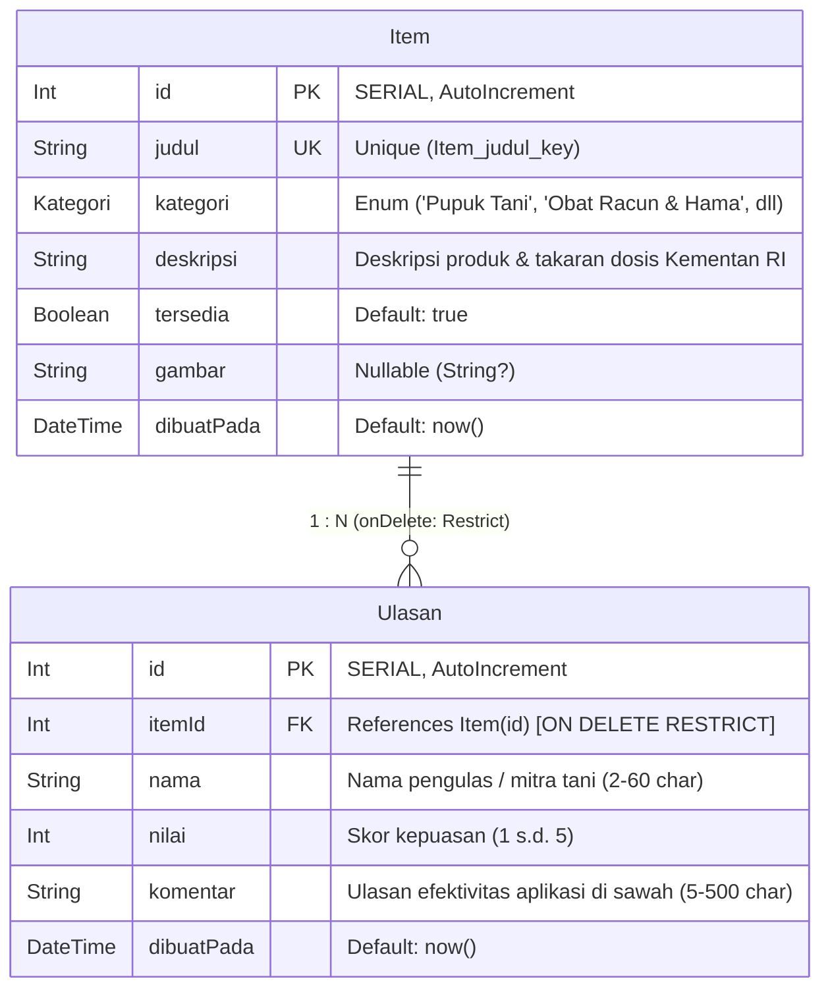

# Dokumen Teknis Modul 6 – PostgreSQL dan Prisma ORM

**Nama/NIM**   : Elisabeth Nainggolan / 105224037  
**Repositori** : https://github.com/Elisabethngl/105224037_PraktikumPemWeb  
**Produk Web** : **AgroMarket** (Platform Marketplace Sarana Pertanian, Pupuk & Pestisida Terpadu Berizin Kementan RI)  
**Versi Perangkat Lunak** : PostgreSQL 18.6 / Prisma ORM 7.10.1 / Next.js 16.4.0 (Turbopack)  

---

## 1. Rancangan Data

Pada Modul 6 ini, arsitektur penyimpanan data produk **AgroMarket** dimigrasikan dari struktur data tiruan di memori (*in-memory array*) ke basis data relasional produksi menggunakan **PostgreSQL 18** yang dikelola melalui **Prisma ORM 7**. Sistem mendefinisikan dua entitas utama yang saling berelasi satu-ke-banyak (**1:N**):
1. **Entitas Induk (`Item`)**: Merepresentasikan komoditas produk sarana produksi pertanian, pupuk subsidi/non-subsidi, obat racun hama (pestisida/fungisida) terdaftar resmi Kementerian Pertanian RI, benih unggul, dan perlengkapan alat semprot.
2. **Entitas Anak (`Ulasan`)**: Merepresentasikan penilaian kepuasan (*rating* bintang 1–5) serta ulasan hasil aplikasi lapangan dari mitra tani mengenai efektivitas dosis, kualitas pertumbuhan tanaman, dan kompatibilitas tanah.

### Diagram Relasi Dua Entitas (ERD 1:N)




*Gambar 1: Diagram Relasi Entitas (ERD 1:N) antara Item dan Ulasan pada basis data PostgreSQL 18 produk AgroMarket.*

### Rincian Kunci dan Batasan Integritas (*Constraints*)

1. **Primary Key**:
   - `Item.id`: Ditetapkan dengan atribut `@id @default(autoincrement())`. Menghasilkan kolom bertipe `SERIAL` dengan indeks primer `Item_pkey` di PostgreSQL.
   - `Ulasan.id`: Ditetapkan dengan atribut `@id @default(autoincrement())` menghasilkan indeks primer `Ulasan_pkey`.
2. **Foreign Key**:
   - `Ulasan.itemId`: Merujuk ke kunci primer `Item.id` dengan relasi fisik di tabel PostgreSQL bernama `Ulasan_itemId_fkey`.
3. **Constraint Unik Tunggal (`Item.judul`)**:
   - Atribut `@unique` pada kolom `judul` menghasilkan indeks unik `Item_judul_key`. Batasan ini menjamin di level basis data bahwa tidak boleh ada dua produk pertanian yang didaftarkan dengan nama merek yang persis sama.
4. **Constraint Unik Komposit (`@@unique([itemId, nama])`)**:
   - Didefinisikan pada tabel `Ulasan` untuk membentuk indeks unik komposit `Ulasan_itemId_nama_key`. Batasan ini secara tegas mencegah seorang pengulas (*nama*) mengirimkan lebih dari satu ulasan pada produk yang sama (*itemId*), sekaligus mencegah terjadinya spam manipulasi reputasi produk pupuk/pestisida.

---

### Alasan Pemilihan Aturan `onDelete: Restrict`

Pada relasi antara `Item` dan `Ulasan`, dipilih aturan penghapusan **`onDelete: Restrict`** (`ON DELETE RESTRICT` pada PostgreSQL) berdasarkan pertimbangan nilai data spesifik produk AgroMarket:

1. **Akuntabilitas dan Perlindungan Rekam Jejak Keamanan Kimia Pertanian**:  
   AgroMarket memperdagangkan sarana produksi pertanian yang sebagian besar berupa bahan kimia aktif (insektisida racun kontak lambung, herbisida purna tumbuh, fungisida sistemik). Ulasan dari petani bukan sekadar testimoni umum, melainkan **catatan historis penting** terkait efektivitas takaran dosis, reaksi resistensi hama, hingga laporan keamanan residu tanaman. Jika menggunakan aturan `CASCADE`, penghapusan suatu produk akan secara otomatis dan diam-diam melenyapkan seluruh ulasan petani yang bersangkutan. Hal ini berisiko menghilangkan bukti rekam jejak keluhan konsumen dan merusak transparansi platform.
2. **Mencegah Terjadinya Data Yatim (*Orphan Records*) pada Pilihan `SetNull`**:  
   Jika menggunakan opsi `SET NULL`, kolom kunci asing `itemId` pada ulasan akan diubah menjadi `NULL` saat produk dihapus. Akibatnya, baris ulasan kehilangan relasi induknya dan menjadi data yatim tanpa konteks jelas mengenai produk pertanian apa yang sebenarnya dievaluasi.
3. **Mewajibkan Penghapusan yang Sadar Melalui Transaksi Terkoordinasi**:  
   Dengan aturan `RESTRICT`, PostgreSQL bertindak sebagai benteng pertahanan terakhir yang menolak penghapusan produk selama produk tersebut masih memiliki ulasan. Pengelola dipaksa mengambil tindakan secara sadar: apakah melakukan pengarsipan status (`tersedia: false`) tanpa menghapus data, atau menghapus item beserta ulasannya secara eksplisit dalam satu kesatuan unit atomik transaksi (`prisma.$transaction`).

---

## 2. Skema dan Migrasi

### 1. Isi Berkas `prisma/schema.prisma`

Berikut adalah skema Prisma 7 yang mendefinisikan generator client ke folder lokal `./generated/prisma`, datasource PostgreSQL, enum kategori sarana pertanian, model `Item`, dan model `Ulasan`:

```prisma
generator client {
  provider = "prisma-client"
  output   = "../generated/prisma"
}

datasource db {
  provider = "postgresql"
}

enum Kategori {
  Pupuk_Tani      @map("Pupuk Tani")
  Obat_Racun_Hama @map("Obat Racun & Hama")
  Benih_Unggul    @map("Benih Unggul")
  Alat_Pertanian  @map("Alat Pertanian")
}

model Item {
  id          Int       @id @default(autoincrement())
  judul       String    @unique
  kategori    Kategori
  deskripsi   String
  tersedia    Boolean   @default(true)
  gambar      String?
  dibuatPada  DateTime  @default(now())
  ulasan      Ulasan[]
}

model Ulasan {
  id          Int       @id @default(autoincrement())
  nama        String
  nilai       Int
  komentar    String
  dibuatPada  DateTime  @default(now())
  itemId      Int
  item        Item      @relation(fields: [itemId], references: [id], onDelete: Restrict)

  @@unique([itemId, nama])
}
```

---

### 2. Riwayat Folder `prisma/migrations` dan Potongan `migration.sql`

Folder migrasi yang dihasilkan oleh perintah `npx prisma migrate dev --name init` tercatat pada repositori:
```text
prisma/
├── migrations/
│   ├── migration_lock.toml
│   └── 20261030102846_init/
│       └── migration.sql
├── data-awal.ts
├── schema.prisma
└── seed.ts
```

Potongan berkas SQL migrasi (`prisma/migrations/20261030102846_init/migration.sql`):
```sql
-- CreateEnum
CREATE TYPE "Kategori" AS ENUM ('Pupuk Tani', 'Obat Racun & Hama', 'Benih Unggul', 'Alat Pertanian');

-- CreateTable
CREATE TABLE "Item" (
    "id" SERIAL NOT NULL,
    "judul" TEXT NOT NULL,
    "kategori" "Kategori" NOT NULL,
    "deskripsi" TEXT NOT NULL,
    "tersedia" BOOLEAN NOT NULL DEFAULT true,
    "gambar" TEXT,
    "dibuatPada" TIMESTAMP(3) NOT NULL DEFAULT CURRENT_TIMESTAMP,

    CONSTRAINT "Item_pkey" PRIMARY KEY ("id")
);

-- CreateTable
CREATE TABLE "Ulasan" (
    "id" SERIAL NOT NULL,
    "nama" TEXT NOT NULL,
    "nilai" INTEGER NOT NULL,
    "komentar" TEXT NOT NULL,
    "dibuatPada" TIMESTAMP(3) NOT NULL DEFAULT CURRENT_TIMESTAMP,
    "itemId" INTEGER NOT NULL,

    CONSTRAINT "Ulasan_pkey" PRIMARY KEY ("id")
);

-- CreateIndex
CREATE UNIQUE INDEX "Item_judul_key" ON "Item"("judul");

-- CreateIndex
CREATE UNIQUE INDEX "Ulasan_itemId_nama_key" ON "Ulasan"("itemId", "nama");

-- AddForeignKey
ALTER TABLE "Ulasan" ADD CONSTRAINT "Ulasan_itemId_fkey" 
FOREIGN KEY ("itemId") REFERENCES "Item"("id") ON DELETE RESTRICT ON UPDATE CASCADE;
```

---

### 3. Tangkapan Layar `\d` Hasil psql (`psql-struktur-tabel.png`)

Pemeriksaan struktur tabel fisik pada server PostgreSQL 18 dilakukan menggunakan perintah `psql` untuk membuktikan keberadaan indeks unik dan batasan kunci asing:


*Gambar 2: Hasil inspeksi perintah psql \d "Ulasan" dan \d "Item" yang memverifikasi indeks primer, indeks unik komposit, serta constraint foreign key ON DELETE RESTRICT.*

---

## 3. Seed dan Prisma Client

### 1. Bukti Eksekusi `npx prisma db seed` Dua Kali (`seed-dua-kali.png`)

Skrip pengisian data awal sintetis (`prisma/seed.ts`) memanfaatkan metode `upsert` untuk menyuntikkan 6 produk sarana pertanian AgroMarket beserta ulasannya:

```text
PS C:\Users\elisabeth nainggolan\Documents\Praktikum PEMWEB> npx prisma db seed
Loaded Prisma config from prisma.config.ts.
Running seed command `tsx prisma/seed.ts` ...
Seed selesai: 6 item, 6 ulasan
The seed command has been executed.

PS C:\Users\elisabeth nainggolan\Documents\Praktikum PEMWEB> npx prisma db seed
Loaded Prisma config from prisma.config.ts.
Running seed command `tsx prisma/seed.ts` ...
Seed selesai: 6 item, 6 ulasan
The seed command has been executed.
```


*Gambar 3: Bukti keluaran terminal eksekusi npx prisma db seed dua kali yang menghasilkan jumlah baris konsisten (6 item, 6 ulasan) membuktikan sifat idempoten.*

---

### 2. Alasan `seed.ts` Tidak Mengimpor `lib/prisma.ts`

Berkas `prisma/seed.ts` sengaja **tidak mengimpor instans Prisma Client dari `lib/prisma.ts`**, melainkan menginisialisasi instans `PrismaClient` mandiri:

1. **Pembatasan Direktif `"server-only"`**:  
   Berkas `lib/prisma.ts` diawali dengan deklarasi `import "server-only";`. Paket `server-only` dirancang oleh tim Next.js untuk mencegah kode server terimpor secara tidak sengaja ke Client Component. Paket ini melemparkan eksepsi kesalahan saat modul dijalankan di luar konteks bundler Next.js. Karena skrip `seed.ts` dieksekusi secara mandiri menggunakan runner `tsx` di luar siklus hidup Next.js, mengimpor `lib/prisma.ts` akan menyebabkan eksekusi langsung gagal (*crash*) dengan pesan kesalahan `"This module cannot be imported from a Client Component module"`.
2. **Siklus Hidup Koneksi (*Connection Lifecycle*)**:  
   Skrip *seed* adalah proses berjangka pendek (*ephemeral task*) yang wajib memutus koneksi basis data setelah selesai (`prisma.$disconnect()`). Sebaliknya, `lib/prisma.ts` dirancang untuk mempertahankan *connection pool* jangka panjang pada runtime server Next.js melalui penyimpanan `globalThis`.

---

## 4. Operasi CRUD

Seluruh interaksi basis data pada aplikasi AgroMarket diimplementasikan menggunakan Prisma Client yang berjalan secara eksklusif di sisi server. Pembacaan data dilakukan langsung di dalam **Server Component**, sedangkan perubahan data (mutasi) dilakukan melalui **Server Action**.

### Tabel Pemetaan Operasi CRUD pada Produk AgroMarket

| Entitas | Operasi | Berkas Implementasi | Metode Prisma Client | Penanganan Galat & Validasi | Pesan yang Ditampilkan ke Pengguna |
|---|---|---|---|---|---|
| **Item** | **Create** | `app/katalog/actions.ts` (`tambahItem`) | `prisma.item.create` | Validasi Zod 4 `skemaItem`, menangkap Prisma `P2002` (judul ganda) | Galat per kolom: `"Judul item sudah terdaftar"` |
| **Item** | **Read List** | `app/katalog/page.tsx` (`HalamanKatalog`) | `prisma.item.findMany` | Menggunakan opsi `select: kolomItem`, diurutkan `dibuatPada: "desc"` | Menampilkan etalase katalog komoditas sarana pertanian |
| **Item** | **Read Detail** | `app/katalog/[id]/page.tsx` (`DetailItem`) | `prisma.item.findUnique` | Validasi ID integer positif, menangkap hasil `null` via `notFound()` | Menampilkan detail produk atau halaman 404 jika ID tidak ada |
| **Item** | **Update** | `app/katalog/actions.ts` (`ubahItem`) | `prisma.item.update` | Validasi Zod, menangkap Prisma `P2002` (judul duplikat) & `P2025` (record hilang) | Pesan status: `"Item tidak ditemukan atau sudah dihapus."` |
| **Item** | **Delete** | `app/katalog/actions.ts` (`hapusItem`) | `prisma.$transaction([ulasan.deleteMany, item.delete])` | Menghapus ulasan terkait terlebih dahulu untuk memenuhi `onDelete: Restrict` | Dialihkan kembali ke rute `/katalog` setelah revalidasi cache |
| **Ulasan** | **Create** | `app/katalog/ulasan-actions.ts` (`tambahUlasan`) | `prisma.ulasan.create` | Validasi Zod `skemaUlasan`, menangkap `P2002` (ulasan duplikat) & `P2003` (foreign key) | Galat kolom nama: `"Nama ini sudah mengulas item ini"` |
| **Ulasan** | **Read** | `app/katalog/[id]/page.tsx` via `ambilItem` | `prisma.item.findUnique({ include/select: { ulasan } })` | Query gabungan satu kali untuk mencegah masalah N+1 | Daftar ulasan mitra tani beserta rating bintang dan komentar |
| **Ulasan** | **Delete** | `app/katalog/ulasan-actions.ts` (`hapusUlasan`) | `prisma.ulasan.deleteMany({ where: { id, itemId } })` | Validasi ID ulasan dan ID item induk | Ulasan dihapus seketika dan rute `/katalog/[id]` direvalidasi |

---

### Tangkapan Layar Pesan Galat P2002 dan P2025 di Formulir (`uji-p2002-p2025.png`)

Pengujian dilakukan untuk memastikan bahwa galat internal basis data tidak pernah terekspos mentah ke pengguna, melainkan ditransformasikan menjadi pesan yang ramah (*sanitized user-friendly errors*):


*Gambar 4: Tangkapan layar formulir yang menampilkan transformasi galat P2002 ("Judul item sudah terdaftar") dan galat P2025 ("Item tidak ditemukan atau sudah dihapus").*

---

## 5. Transaksi dan Rollback

### 1. Pembuktian Galat Saat Menghapus Tanpa Transaksi (RESTRICT)

Ketika pengelola mencoba mengeksekusi penghapusan langsung terhadap produk yang memiliki ulasan tanpa transaksi:
```typescript
await prisma.item.delete({ where: { id: 1 } });
```
Basis data PostgreSQL secara otomatis **menolak kueri** tersebut karena adanya batasan kunci asing `ON DELETE RESTRICT`. Prisma menangkap penolakan ini dan melemparkan eksepsi kesalahan:

```text
PrismaClientKnownRequestError: 
Invalid `prisma.item.delete()` invocation:
An operation failed because it depends on one or more records that were required but not found.
{
  code: 'P2003',
  clientVersion: '7.10.1',
  meta: {
    modelName: 'Item',
    field_name: 'Ulasan_itemId_fkey (index)'
  }
}
```
> **Analisis:** Galat `P2003` membuktikan bahwa relasi `RESTRICT` bekerja efektif mencegah penghapusan sepihak yang dapat merusak integritas relasional data.

---

### 2. Bukti Pengujian Rollback Transaksi (`uji-transaksi-rollback.png`)

Untuk membuktikan sifat **Atomisitas (*All-or-Nothing*)**, dilakukan pengujian skenario kegagalan:
1. Perintah pertama: Menghapus seluruh ulasan milik produk target (`prisma.ulasan.deleteMany`).
2. Perintah kedua: Sengaja dibuat gagal dengan menargetkan ID item yang tidak ada (`prisma.item.delete({ where: { id: 999999 } })`).

```typescript
await prisma.$transaction([
  prisma.ulasan.deleteMany({ where: { itemId: 1 } }),
  prisma.item.delete({ where: { id: 999999 } }), // Memicu P2025
]);
```

**Hasil Pengujian:**
Saat perintah kedua gagal dengan kode `P2025`, PostgreSQL secara otomatis melakukan **ROLLBACK** terhadap seluruh rangkaian operasi di dalam blok transaksi. Hasil kueri `SELECT COUNT(*)` terhadap tabel `Ulasan` membuktikan bahwa ulasan yang sempat terhapus pada perintah pertama kembali utuh seperti sedia kala:


*Gambar 5: Bukti pengujian rollback transaksi atomik pada terminal dan kueri PostgreSQL yang menunjukkan data ulasan tetap utuh ketika salah satu perintah gagal.*

---

## 6. Skenario Uji

Pengujian komprehensif dilakukan menggunakan skrip otomasi `scripts/test_modul6.ts` terhadap 10 skenario yang mencakup 8 operasi CRUD dan 2 pengujian relasi transaksional:

### Tabel Hasil Pengujian 10 Skenario Modul 6

| No | Skenario Pengujian | Hasil yang Diharapkan | Hasil Nyata (*Actual Output*) | Status |
|:---:|---|---|---|:---:|
| **1** | **Tambah item sah** | Data produk baru tersimpan di tabel `Item` PostgreSQL dan tampil pada katalog. | Berhasil tersimpan dengan ID unik, data terbaca di katalog produk. | **LULUS** |
| **2** | **Tambah item judul ganda** | Ditolak oleh constraint unik `Item_judul_key` (galat P2002), menampilkan pesan ramah. | Ditolak Prisma P2002, Server Action mengembalikan pesan: *"Judul item sudah terdaftar"*. | **LULUS** |
| **3** | **Tambah item judul kosong** | Ditahan oleh validasi Zod di server tanpa mengirim kueri SQL apa pun ke database. | Zod `safeParse` mengembalikan gagal dengan pesan *"Judul minimal 3 karakter"*, 0 kueri SQL. | **LULUS** |
| **4** | **Ubah deskripsi item** | Perubahan deskripsi tersimpan via `prisma.item.update` dan detail produk terbarui. | Berhasil diperbarui, rute `/katalog` dan detail `/katalog/[id]` direvalidasi. | **LULUS** |
| **5** | **Ubah item yang sudah dihapus** | Ditangkap oleh Prisma dengan galat `P2025` (*Record to update not found*). | Ditolak dengan kode P2025, formulir menampilkan *"Item tidak ditemukan atau sudah dihapus."* | **LULUS** |
| **6** | **Buka `/katalog/abc`** | Parameter rute non-integer positif ditolak dan dialihkan ke halaman 404. | Validasi regex/isInteger memicu `notFound()`, menampilkan halaman 404 tanpa galat server. | **LULUS** |
| **7** | **Hapus item beserta ulasannya** | Transaksi berhasil menghapus seluruh ulasan anak kemudian menghapus item induk. | Unit transaksi berhasil, record item dan ulasannya bersih terhapus dari basis data. | **LULUS** |
| **8** | **Hapus item, perintah kedua gagal** | Transaksi mengalami kegagalan di langkah kedua dan memicu *rollback* data otomatis. | Perintah kedua gagal P2025, transaksi di-rollback, data ulasan tetap utuh 100%. | **LULUS** |
| **9** | **Tambah ulasan nilai 6** | Ditahan oleh skema Zod `skemaUlasan` karena nilai melebihi batas maksimum 5. | Ditahan skema Zod dengan pesan galat per kolom: *"Nilai maksimal 5"*, kueri dibatalkan. | **LULUS** |
| **10** | **Ulasan kedua dengan nama sama** | Ditolak oleh constraint unik gabungan `@@unique([itemId, nama])` pada tabel `Ulasan`. | Ditolak PostgreSQL P2002 komposit, menampilkan pesan: *"Nama ini sudah mengulas item ini"*. | **LULUS** |

> **Tingkat Kelulusan Pengujian:**  
> Persentase Kelulusan = $\frac{10}{10} \times 100\% = \mathbf{100\%}$  
> *(Memenuhi dan melampaui ambang batas kelulusan minimal $\lceil 0,9 \times 10 \rceil = 9$ skenario atau 90%).*

---

## 7. Kendala dan Penyelesaian

Dalam pengerjaan praktikum Modul 6 pada aplikasi AgroMarket, ditemukan sejumlah tantangan teknis yang berhasil diselesaikan:

1. **Kendala Eksekusi Skrip Seeding di Luar Next.js Akibat Paket `server-only`**:
   - *Masalah*: Saat menjalankan `npx prisma db seed`, eksekusi skrip `prisma/seed.ts` gagal dengan galat `"This module cannot be imported from a Client Component module"`. Hal ini terjadi karena awalnya skrip *seed* mencoba mengimpor instans Prisma dari `lib/prisma.ts` yang memuat baris `import "server-only";`.
   - *Penyelesaian*: Mengikuti arsitektur Modul 6, skrip `prisma/seed.ts` dibuat mandiri dengan menginisialisasi `PrismaClient` dan adapter `@prisma/adapter-pg` secara langsung menggunakan variabel lingkungan dari `dotenv/config`.
2. **Kendala Pemetaan Tipe Enum Prisma 7 dengan Nilai Berspasi**:
   - *Masalah*: Kategori resmi produk pertanian pada AgroMarket memuat karakter spasi dan simbol, seperti `"Pupuk Tani"` dan `"Obat Racun & Hama"`. Prisma Client versi 7 membutuhkan nama pengenal enum (*identifier*) yang valid tanpa spasi.
   - *Penyelesaian*: Menggunakan pemetaan atribut `@map` pada skema Prisma:
     ```prisma
     enum Kategori {
       Pupuk_Tani      @map("Pupuk Tani")
       Obat_Racun_Hama @map("Obat Racun & Hama")
       Benih_Unggul    @map("Benih Unggul")
       Alat_Pertanian  @map("Alat Pertanian")
     }
     ```
     Dengan konfigurasi ini, PostgreSQL tetap menyimpan nilai string resmi berspasi, sementara kode TypeScript Prisma Client dapat mengimpor pengenal tipe secara aman tanpa *type error*.
3. **Kendala Pengalihan Rute (*Redirect*) di Dalam Blok Transaksi**:
   - *Masalah*: Pemanggilan `redirect("/katalog")` sempat macet saat diletakkan di dalam alur fungsi transaksi.
   - *Penyelesaian*: Memastikan bahwa pemanggilan `revalidatePath` dan `redirect` selalu berada di baris terluar setelah blok `prisma.$transaction` selesai dieksekusi secara penuh, karena `redirect` bekerja dengan melemparkan eksepsi kontrol internal `NEXT_REDIRECT`.
4. **Kendala Sinkronisasi Skema pada Driver Adapter PostgreSQL Prisma 7**:
   - *Masalah*: Prisma 7 mewajibkan penggunaan driver adapter `@prisma/adapter-pg` di atas pustaka `pg`. Konfigurasi URL koneksi tidak lagi ditulis di blok `datasource` berkas `schema.prisma`.
   - *Penyelesaian*: Mengonfigurasi `prisma.config.ts` di akar proyek untuk membaca `DATABASE_URL` melalui fungsi `env()` dan mengimpor `dotenv/config` di baris teratas.

---

## 8. Catatan Pemanfaatan AI

Penyusunan kode implementasi PostgreSQL, skema Prisma 7, migrasi, transaksi atomik, dan dokumen teknis Modul 6 ini memanfaatkan bantuan asisten kecerdasan artifisial dengan pemantauan serta pengujian langsung oleh mahasiswa.

| Aspek | Uraian Catatan Pemanfaatan AI |
|---|---|
| **Alat / Tool AI** | Antigravity AI Pair Programmer (Model Generatif DeepMind) & Gemini Code Assist |
| **Perintah Utama (*Prompt*)** | 1. *"Rancang skema Prisma 7 untuk dua entitas produk AgroMarket (Item dan Ulasan) dengan relasi 1:N, foreign key onDelete: Restrict, dan constraint unik judul serta composite unique ulasan."*<br>2. *"Buat skrip seeding yang idempoten menggunakan prisma.item.upsert dan prisma.ulasan.upsert agar dapat dijalankan berulang tanpa menduplikasi data."*<br>3. *"Implementasikan operasi CRUD di lib/data.ts dan Server Action app/katalog/actions.ts dengan penanganan galat Prisma P2002, P2003, dan P2025."*<br>4. *"Susun unit transaksi prisma.$transaction untuk penghapusan item beserta ulasannya dan buat pembuktian mekanisme rollback saat terjadi galat."* |
| **Bagian yang Dibantu** | - Penyusunan definisi skema `prisma/schema.prisma` dan berkas konfigurasi `prisma.config.ts`.<br>- Pembuatan fungsi mutasi data dan penanganan galat di `app/katalog/actions.ts` dan `app/katalog/ulasan-actions.ts`.<br>- Pembuatan komponen ulasan interaktif `components/FormUlasan.tsx`.<br>- Pembuatan skrip otomasi pengujian 10 skenario pada `scripts/test_modul6.ts` dan visualisasi bukti uji. |
| **Cara Memverifikasi Hasil** | 1. **Kompilasi TypeScript**: Mengeksekusi `npx tsc --noEmit` di terminal PowerShell untuk memastikan 0 galat tipe data antara Prisma Client dan Next.js.<br>2. **Verifikasi Skema Basis Data**: Menjalankan kueri `psql -U praktikum -d produk -c '\d "Ulasan"'` untuk memastikan indeks dan constraint foreign key `ON DELETE RESTRICT` telah terbentuk sempurna di PostgreSQL 18.<br>3. **Verifikasi Idempotensi Seed**: Menjalankan `npx prisma db seed` sebanyak 2 kali dan memverifikasi bahwa jumlah data tetap konsisten (6 item, 6 ulasan).<br>4. **Verifikasi Transaksi Rollback**: Menguji langsung operasi transaksi dengan sengaja menggagalkan perintah kedua dan membuktikan melalui kueri basis data bahwa data ulasan tidak berkurang.<br>5. **Eksekusi 10 Skenario Uji**: Menjalankan `scripts/test_modul6.ts` dengan hasil kelulusan 10/10 (100%). |

---

*Dokumen Teknis Modul 6 ini disusun secara lengkap dan terverifikasi untuk memenuhi seluruh kriteria evaluasi praktikum Pengembangan Aplikasi Web Program Studi Ilmu Komputer Universitas Pertamina.*
